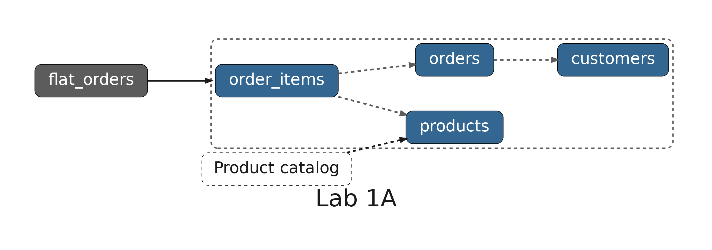
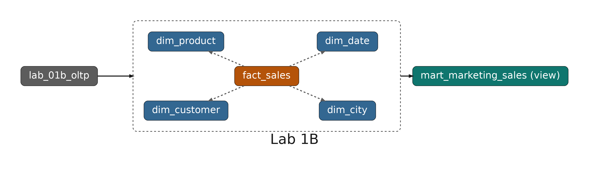
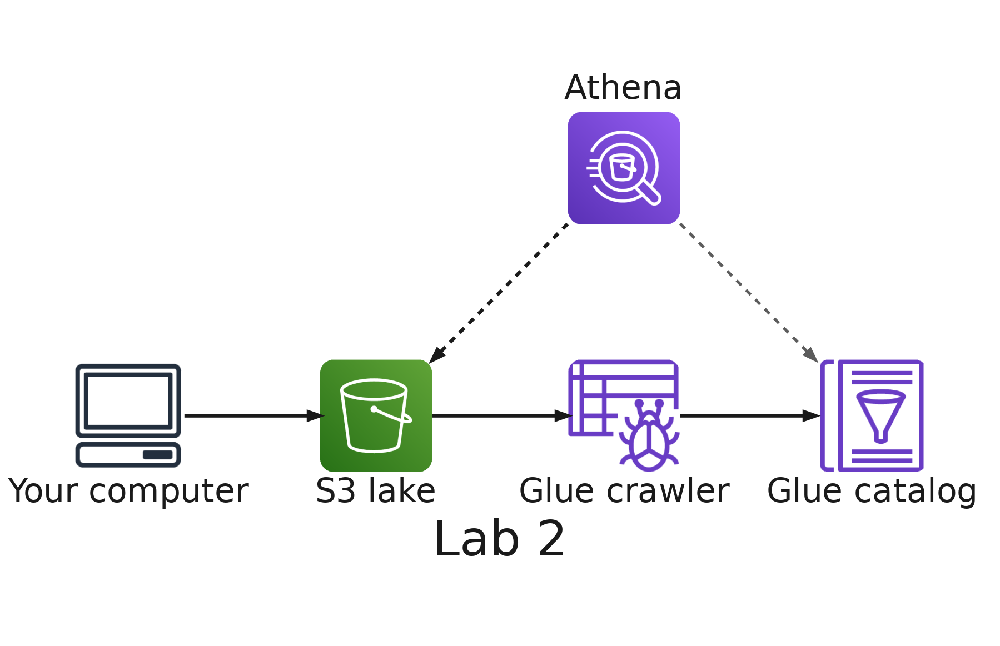
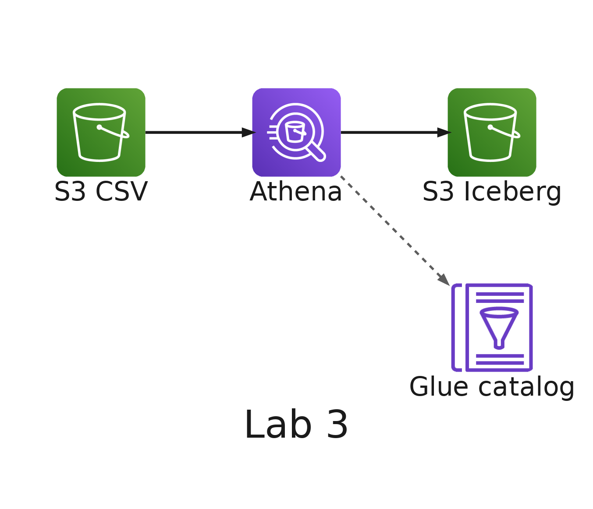
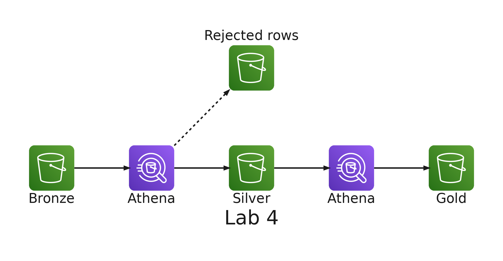
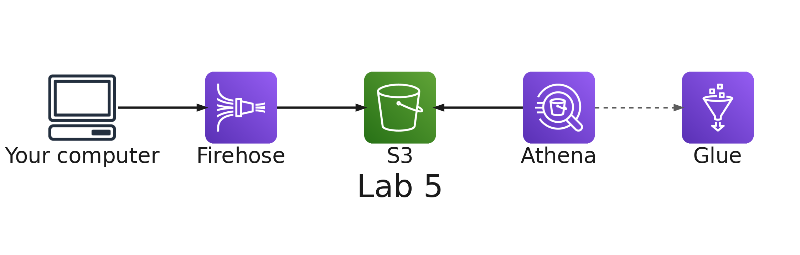
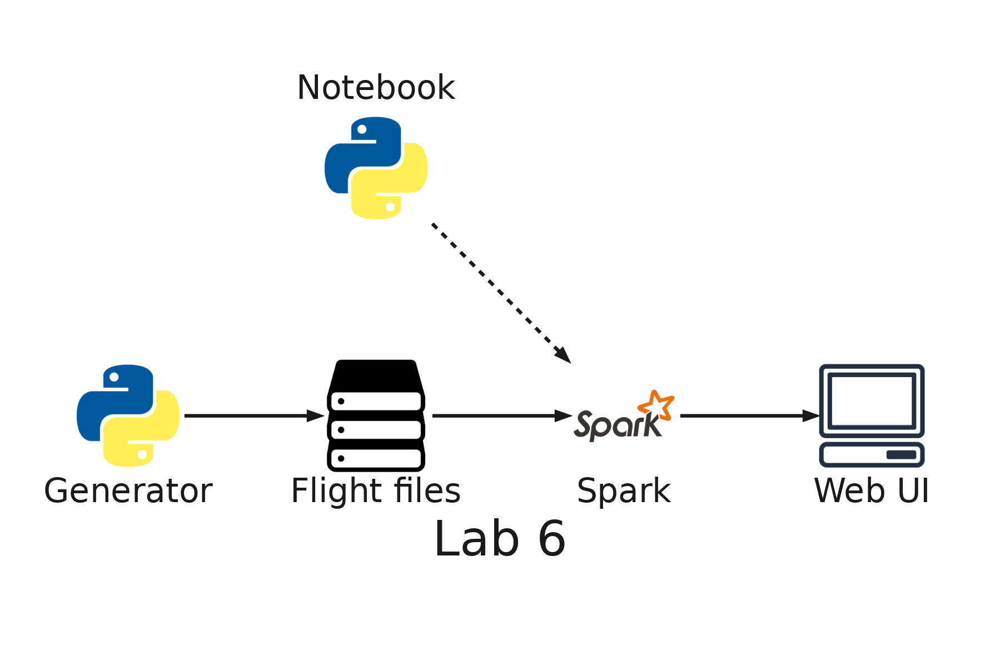
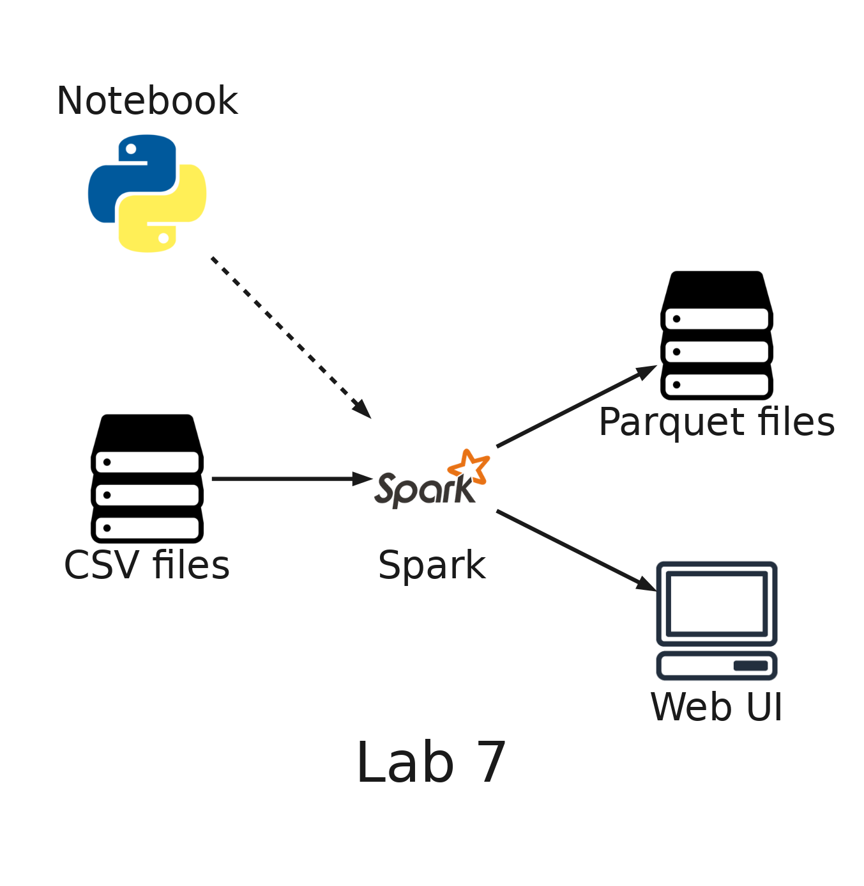

# README

- [README](#readme)
  - [Summary](#summary)
    - [The labs](#the-labs)
    - [Repository structure](#repository-structure)
  - [Setup](#setup)
    - [Development container](#development-container)
    - [Environment variables](#environment-variables)
    - [Local services](#local-services)
    - [Windows](#windows)
    - [Deployment](#deployment)
    - [Remove](#remove)
  - [Glossary](#glossary)
    - [AWS environment variables: `.envs/aws.env`](#aws-environment-variables-envsawsenv)
    - [Serverless Framework environment variables: `.envs/sls.env`](#serverless-framework-environment-variables-envsslsenv)
  - [License](#license)

---

## Summary

`Big Data Labs` is the set of hands-on labs of **SI7006 Storage and Processing of Big Data** (EAFIT, master's program in Data Science and Analytics). The labs follow the course presentations. The first ones use an online store as their example, with orders, customers, products, reviews, product photos and click events. Later labs may use a different context.

It is built as a teaching project: every lab runs inside Docker, so nothing is installed on your computer except Docker and an editor. The labs that use AWS deploy to your own AWS account with Serverless Framework, and their READMEs end with the steps that remove everything they created.

### The labs

| Lab | Topic                                                          | Runs on          | Status |
| --- | -------------------------------------------------------------- | ---------------- | ------ |
| 1A  | OLTP anomalies, normalization and JOINs                        | Local PostgreSQL | Ready  |
| 1B  | Star schema, a query by category and month, and a data mart    | Local PostgreSQL | Ready  |
| 2   | Data lake: S3, a Glue crawler and Athena                       | AWS              | Ready  |
| 3   | Apache Iceberg table: update, schema evolution and time travel | AWS              | Ready  |
| 4   | Medallion layers (bronze, silver, gold) with SQL in Athena     | AWS              | Ready  |
| 5   | Streaming click events to S3 with Firehose                     | AWS              | Ready  |
| 6   | Apache Spark on your computer, with the flights of an airline  | Local Spark      | Ready  |
| 7   | Parquet files, partitioning and compression with Spark         | Local Spark      | Ready  |

Labs 1, 6 and 7 run only on your computer. Labs 2 to 4 work with the free plan of your AWS account. Lab 5, and the labs after it, need the paid plan, and its README explains how to upgrade. Labs 2 to 4 share one base stack (an S3 bucket with zones, a Glue database and an Athena workgroup), deployed once. Lab 5 has its own stack. Each lab has its own README with its steps and how to remove what it created. Labs 2 to 4 remove the base stack together, at the end of lab 4.

| Lab 1A: normalization                                                                                                          | Lab 1B: star schema                                                                                                   |
| ------------------------------------------------------------------------------------------------------------------------------ | --------------------------------------------------------------------------------------------------------------------- |
|  |  |

| Lab 2: data lake                                                                                                 | Lab 3: Iceberg                                                                                               |
| ---------------------------------------------------------------------------------------------------------------- | ------------------------------------------------------------------------------------------------------------ |
|  |  |

| Lab 4: medallion layers                                                                                          | Lab 5: Firehose                                                                                                |
| ---------------------------------------------------------------------------------------------------------------- | -------------------------------------------------------------------------------------------------------------- |
|  |  |

| Lab 6: Spark on your computer                                                                                 | Lab 7: Parquet and partitioning                                                                                                 |
| ------------------------------------------------------------------------------------------------------------- | ------------------------------------------------------------------------------------------------------------------------------- |
|  |  |

### Repository structure

- **`.docker/`**: the multi-stage `Dockerfile`, `docker-compose.yml` (the development container, PostgreSQL and pgAdmin) and the scripts the container runs when it is created.
- **`.envs/`**: your credentials, git-ignored. The `*.example` files show which variables you need.
- **`docs/`**: the diagram of each lab (the data model of labs 1A and 1B, the architecture of the AWS labs), in a full and a small size, generated from `docs/architecture.py` with `python3 docs/architecture.py`.
- **`labs/`**: one folder per lab, `labs/<NN>-<name>/`. Code shared by several labs, such as the data generator, lives in `labs/shared/`.

---

## Setup

### Development container

These steps are tailored to work with Visual Studio Code, but you are free to choose a different IDE and make necessary adjustments to the setup.

1. Install `ms-vscode-remote.remote-containers` extension. If you don't know how to do that follow these steps: <https://code.visualstudio.com/docs/editor/extension-gallery#_install-an-extension>
2. Open this project's folder in Visual Studio Code. The extension will detect a container configuration and will ask you if you want to reopen the project in the container. Accept. The first time, Docker builds the image, which takes a few minutes.

### Environment variables

At `.envs` folder, copy `aws.env.example` to `aws.env` and `sls.env.example` to `sls.env`, and fill them in with the variables described [here](#glossary). You need them only for the labs that run on AWS: lab 1 works without them.

### Local services

The development container starts two more services, and publishes the web UI of Spark:

- **PostgreSQL**: `localhost:5432`, user `postgres`, password `example`, database `shop`. Inside the development container, `psql` already points to it, so you can run `psql` with no flags.
- **pgAdmin**: <http://localhost:5050>. The server is already registered; the first time you connect, it asks for the password: `example`.
- **Spark web UI**: <http://localhost:4040>. It answers only while a Spark session of lab 6 or 7 is open.

### Windows

The repository forces LF line endings through `.gitattributes`, so the scripts that run inside the container work regardless of your Git configuration (`core.autocrlf`).

Use Docker Desktop with the WSL 2 backend, and clone the repository inside the Linux file system of your WSL distribution (for example, in your home folder) instead of under `/mnt/c`. Docker's documentation explains that performance is much higher when bind-mounted files live in the Linux file system: <https://docs.docker.com/desktop/features/wsl/best-practices/>

### Deployment

You can deploy `Cloud Formation Stacks` using `Serverless Framework` syntax: <https://www.serverless.com/framework/docs/providers/aws/cli-reference/deploy/>

The labs that deploy their own stacks keep them under `labs/<NN>-<name>/serverless/`, and the base stack shared by labs 2 to 4 is in `labs/shared/serverless/base/`. Follow the lab's README for the deployment order. The stacks deploy to `us-east-1`: set `AWS_DEFAULT_REGION=us-east-1` in `.envs/aws.env`.

### Remove

You must use `Serverless Framework` remove command as primary option: <https://www.serverless.com/framework/docs/providers/aws/cli-reference/remove/>

If `remove` command fails for whatever reason, you'll need to investigate the reason using `AWS Console` at your browser, solve the issue and then re-attempt the `remove` command.

You can, alternatively, delete the `AWS Cloud Formation` stack manually using `AWS Console` at your browser. But it's recommended to do it using the `remove` command from Serverless Framework.

`Cloud Formation` cannot delete an S3 bucket that still has objects. The lab READMEs include the step that empties the bucket before you remove its stack. `serverless remove` also leaves each stack's deployment bucket behind, empty, so the lab READMEs delete it with `aws s3 rb`.

---

## Glossary

### AWS environment variables: `.envs/aws.env`

- `AWS_ACCESS_KEY_ID`: _Access Key_ used to deploy Cloud Formation stack to AWS cloud. The owner of the _Access Key_ need to have sufficient IAM permissions to perform the deployment process.
- `AWS_SECRET_ACCESS_KEY`: _Secret Access Key_ that matches the _Access Key_
- `AWS_DEFAULT_REGION`: Region where you intend to deploy the stack
- `AWS_DEFAULT_OUTPUT`: Default response format for AWS CLI commands

### Serverless Framework environment variables: `.envs/sls.env`

- `SERVERLESS_ACCESS_KEY`: Serverless _Secret API Key_. Needed to deploy stack information to Serverless cloud.

---

## License

[MIT](LICENSE)
