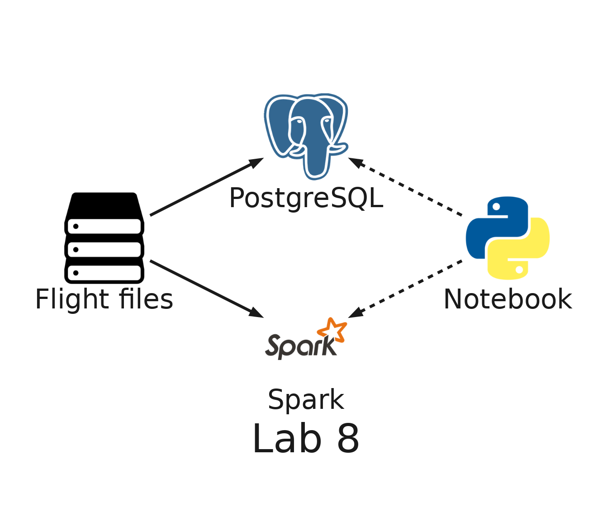
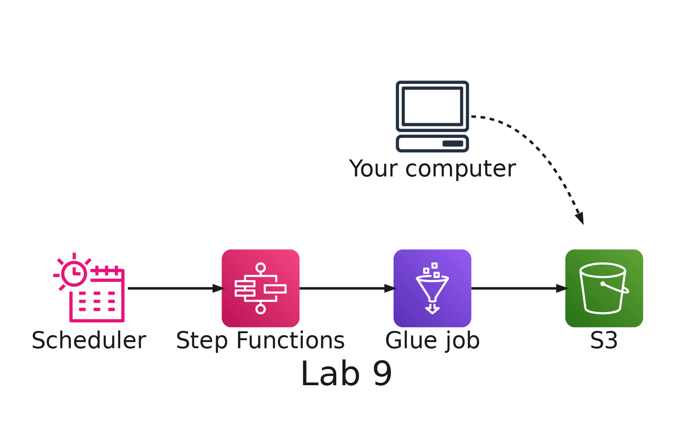
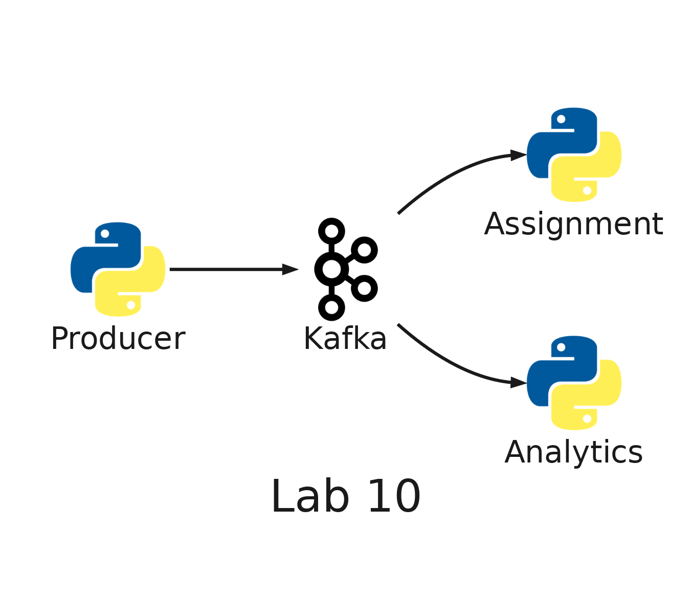
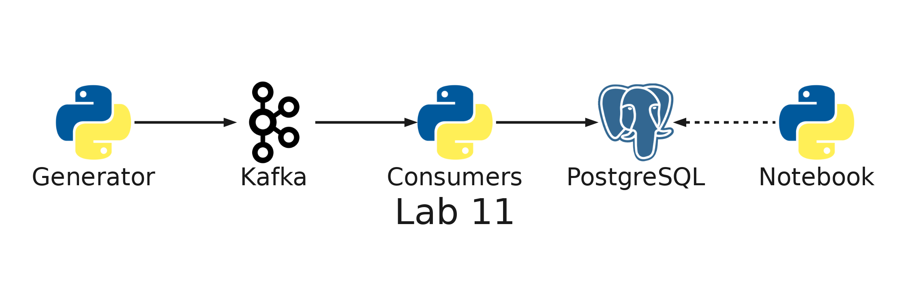
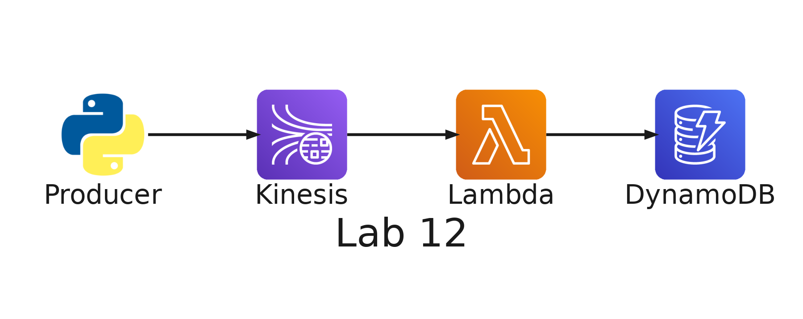
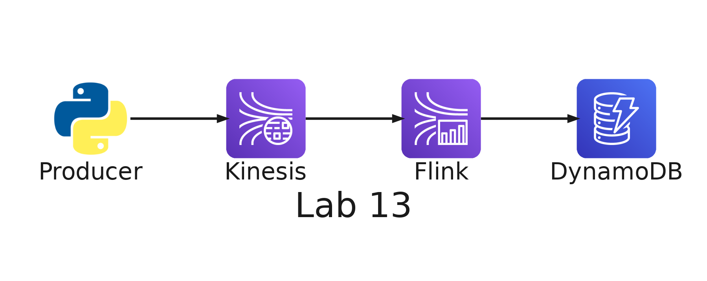

# README

- [README](#readme)
  - [Summary](#summary)
    - [The labs](#the-labs)
    - [Repository structure](#repository-structure)
  - [Setup](#setup)
    - [Development container](#development-container)
    - [Environment variables](#environment-variables)
    - [Local services](#local-services)
    - [Windows](#windows)
    - [Deployment](#deployment)
    - [Remove](#remove)
  - [Glossary](#glossary)
    - [AWS environment variables: `.envs/aws.env`](#aws-environment-variables-envsawsenv)
    - [Serverless Framework environment variables: `.envs/sls.env`](#serverless-framework-environment-variables-envsslsenv)
  - [License](#license)

---

## Summary

`Big Data Labs` is the set of hands-on labs of **SI7006 Storage and Processing of Big Data** (EAFIT, master's program in Data Science and Analytics). The labs follow the course presentations. Labs 1 to 5 use an online store as their example, labs 6 to 9 the flights of an airline, and labs 10 to 13 a delivery app.

It is built as a teaching project: every lab runs inside Docker, so nothing is installed on your computer except Docker and an editor. The labs that use AWS deploy to your own AWS account with Serverless Framework, and their READMEs end with the steps that remove everything they created.

### The labs

| Lab | Topic                                                                       | Runs on          |
| --- | --------------------------------------------------------------------------- | ---------------- |
| 1A  | OLTP anomalies, normalization and JOINs                                     | Local PostgreSQL |
| 1B  | Star schema, a query by category and month, and a data mart                 | Local PostgreSQL |
| 2   | Data lake: S3, a Glue crawler and Athena                                    | AWS              |
| 3   | Apache Iceberg table: update, schema evolution and time travel              | AWS              |
| 4   | Medallion layers (bronze, silver, gold) with SQL in Athena                  | AWS              |
| 5   | Streaming click events to S3 with Firehose                                  | AWS              |
| 6   | Apache Spark on your computer, with the flights of an airline               | Local Spark      |
| 7   | Parquet files, partitioning and compression with Spark                      | Local Spark      |
| 8   | PostgreSQL and Spark SQL on the same flights                                | Local Spark      |
| 9   | A batch pipeline: a Spark job in AWS Glue, Step Functions and a schedule    | AWS              |
| 10  | Apache Kafka on your computer: partitions, offsets and consumer groups      | Local Kafka      |
| 11  | From Kafka to PostgreSQL: a live pipeline, repeated events and reprocessing | Local Kafka      |
| 12  | Order events in real time: Kinesis Data Streams, Lambda and DynamoDB        | AWS              |
| 13  | Windows of one minute with Apache Flink on order events                     | AWS              |

Labs 1, 6, 7, 8, 10 and 11 run only on your computer. Labs 2 to 4 work with the free plan of your AWS account; from lab 5 on, the AWS labs assume the paid plan, and the README of lab 5 explains how to upgrade. Labs 2 to 4 share one base stack (an S3 bucket with zones, a Glue database and an Athena workgroup), deployed once and removed together at the end of lab 4. Lab 2 also has a crawler stack, and labs 5, 9, 12 and 13 each have their own stack.

| Lab 1A: normalization                                                                                                          | Lab 1B: star schema                                                                                                   |
| ------------------------------------------------------------------------------------------------------------------------------ | --------------------------------------------------------------------------------------------------------------------- |
|  |  |

| Lab 2: data lake                                                                                                 | Lab 3: Iceberg                                                                                               |
| ---------------------------------------------------------------------------------------------------------------- | ------------------------------------------------------------------------------------------------------------ |
|  |  |

| Lab 4: medallion layers                                                                                          | Lab 5: Firehose                                                                                                |
| ---------------------------------------------------------------------------------------------------------------- | -------------------------------------------------------------------------------------------------------------- |
|  |  |

| Lab 6: Spark on your computer                                                                                 | Lab 7: Parquet and partitioning                                                                                                 |
| ------------------------------------------------------------------------------------------------------------- | ------------------------------------------------------------------------------------------------------------------------------- |
|  |  |

| Lab 8: PostgreSQL and Spark SQL                                                                                             | Lab 9: batch pipeline with Glue                                                                                    |
| --------------------------------------------------------------------------------------------------------------------------- | ------------------------------------------------------------------------------------------------------------------ |
|  |  |

| Lab 10: Kafka on your computer                                                                     | Lab 11: from Kafka to PostgreSQL                                                                                     |
| -------------------------------------------------------------------------------------------------- | -------------------------------------------------------------------------------------------------------------------- |
|  |  |

| Lab 12: orders in real time with Kinesis                                                                      | Lab 13: windows with Flink                                                                                |
| ------------------------------------------------------------------------------------------------------------- | --------------------------------------------------------------------------------------------------------- |
|  |  |

### Repository structure

- **`.docker/`**: the multi-stage `Dockerfile`, `docker-compose.yml` (the development container, PostgreSQL, pgAdmin and Kafka) and the scripts the container runs when it is created.
- **`.envs/`**: your credentials, git-ignored. The `*.example` files show which variables you need.
- **`docs/`**: the diagram of each lab (the data model of labs 1A and 1B, the architecture of the AWS labs), in a full and a small size, generated from `docs/architecture.py` with `python3 docs/architecture.py`.
- **`labs/`**: one folder per lab, `labs/<NN>-<name>/`. Code shared by several labs, such as the data generator, lives in `labs/shared/`.

---

## Setup

### Development container

These steps are tailored to work with Visual Studio Code, but you are free to choose a different IDE and make necessary adjustments to the setup.

1. Install `ms-vscode-remote.remote-containers` extension. If you don't know how to do that follow these steps: <https://code.visualstudio.com/docs/editor/extension-gallery#_install-an-extension>
2. Open this project's folder in Visual Studio Code. The extension will detect a container configuration and will ask you if you want to reopen the project in the container. Accept. The first time, Docker builds the image, which takes a few minutes.

### Environment variables

At `.envs` folder, copy `aws.env.example` to `aws.env` and `sls.env.example` to `sls.env`, and fill them in with the variables described [here](#glossary). You need them only for the labs that run on AWS: the local labs work without them.

### Local services

The development container starts three more services, and publishes the web UI of Spark:

- **PostgreSQL**: `localhost:5432`, user `postgres`, password `example`, database `shop`. Inside the development container, `psql` already points to it, so you can run `psql` with no flags.
- **pgAdmin**: <http://localhost:5050>. The server is already registered; the first time you connect, it asks for the password: `example`.
- **Kafka**: `kafka:9092`, reachable only from inside the development container, which is where the scripts of labs 10 and 11 run.
- **Spark web UI**: <http://localhost:4040>. It answers only while a Spark session of lab 6, 7 or 8 is open.

### Windows

The repository forces LF line endings through `.gitattributes`, so the scripts that run inside the container work regardless of your Git configuration (`core.autocrlf`).

Use Docker Desktop with the WSL 2 backend, and clone the repository inside the Linux file system of your WSL distribution (for example, in your home folder) instead of under `/mnt/c`. Docker's documentation explains that performance is much higher when bind-mounted files live in the Linux file system: <https://docs.docker.com/desktop/features/wsl/best-practices/>

### Deployment

The AWS labs deploy CloudFormation stacks with the [Serverless Framework](https://www.serverless.com/framework/docs/providers/aws/cli-reference/deploy/), from the terminal of the development container: `cd <stack folder> && serverless deploy`. The stack of each lab is in `labs/<NN>-<name>/serverless/`, and the base stack shared by labs 2 to 4 is in `labs/shared/serverless/base/`. Follow the README of the lab for the steps and their order. The stacks deploy to `us-east-1`: set `AWS_DEFAULT_REGION=us-east-1` in `.envs/aws.env`.

### Remove

Remove a stack with the [`serverless remove`](https://www.serverless.com/framework/docs/providers/aws/cli-reference/remove/) command. If it fails, find the reason in the AWS Console, fix it and run the command again.

CloudFormation cannot delete an S3 bucket that still has objects, so the lab READMEs empty the bucket before they remove the stack. `serverless remove` also leaves the deployment bucket of each stack behind, empty, so the READMEs delete it with `aws s3 rb`.

---

## Glossary

### AWS environment variables: `.envs/aws.env`

- `AWS_ACCESS_KEY_ID`: _Access Key_ used to deploy Cloud Formation stack to AWS cloud. The owner of the _Access Key_ need to have sufficient IAM permissions to perform the deployment process.
- `AWS_SECRET_ACCESS_KEY`: _Secret Access Key_ that matches the _Access Key_
- `AWS_DEFAULT_REGION`: Region where you intend to deploy the stack
- `AWS_DEFAULT_OUTPUT`: Default response format for AWS CLI commands

### Serverless Framework environment variables: `.envs/sls.env`

- `SERVERLESS_ACCESS_KEY`: _Access Key_ of your Serverless account. The Serverless Framework CLI needs it to run.

---

## License

[MIT](LICENSE)
