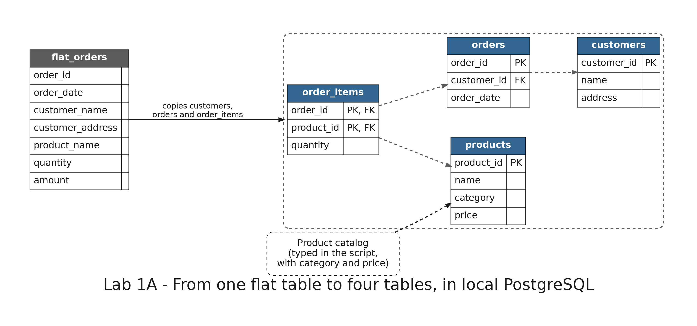

# README

- [README](#readme)
  - [Summary](#summary)
  - [Setup](#setup)
    - [Prerequisites](#prerequisites)
    - [Running the scripts](#running-the-scripts)
    - [Step 1: A flat table](#step-1-a-flat-table)
    - [Step 2: Break it](#step-2-break-it)
    - [Step 3: Normalize it](#step-3-normalize-it)
    - [Step 4: Move the data](#step-4-move-the-data)
    - [Step 5: Rebuild an order with JOIN](#step-5-rebuild-an-order-with-join)
    - [Step 6: Repeat the operations](#step-6-repeat-the-operations)
  - [Remove](#remove)

---

## Summary

`Lab 1A: OLTP anomalies, normalization and JOINs` shows why a single table is a problem for an OLTP system. You break a flat table of orders with three operations, split it into four tables with keys, rebuild an order with `JOIN`, and repeat the three operations on the four tables.

It runs on the local PostgreSQL service and creates nothing in AWS.



---

## Setup

### Prerequisites

The development container must be running with its local services: see [Local services](../../README.md#local-services) in the root README. Open pgAdmin at <http://localhost:5050>, connect to the server `Big Data Labs` (password `example`) and open the database `shop`.

### Running the scripts

The SQL files are in `sql/` and run in order, one per step. Everything they create lives in the schema `lab_01a` (a schema groups tables inside a database), and every table name starts with it: `lab_01a.flat_orders` is the table `flat_orders` of that schema.

With pgAdmin, right-click the database `shop` and choose **Query Tool**. Copy the file from Visual Studio Code and paste it in the Query Tool. Highlight the block you want to run and click **Execute script** (or press **F5**): pgAdmin runs only the highlighted text. Files with several blocks run one block at a time.

With `psql`, from the terminal of the development container, in the repository folder:

```bash
psql -f labs/01a-oltp-normalization/sql/01_flat_orders.sql
```

`psql` runs a whole file at once. Some statements fail on purpose, and the file says so.

### Step 1: A flat table

Run `01_flat_orders.sql`. It creates the table `flat_orders`, with the customer, the address, the product, the quantity and the amount of each order line in one row.

Expected: 6 rows. The data of Ana Pérez is repeated in three of them.

### Step 2: Break it

Run `02_anomalies.sql` block by block. The experiments run on a copy of the table, `flat_orders_copy`, so the original stays intact.

- **Block 1, update:** Ana moves, and someone updates only one of her rows. Expected: Ana has two different addresses.
- **Block 2, delete:** Marta's only order is deleted. Expected: Marta disappears from the list of customers.
- **Block 3, insert:** a new customer with no orders tries to register. Expected: an error, `null value in column "order_id" violates not-null constraint`.

Question: why can the table not keep a customer who has not bought anything?

### Step 3: Normalize it

Run `03_normalize.sql`. It creates `customers`, `products`, `orders` and `order_items`. Each table has a primary key (`PRIMARY KEY`), and the tables that point to another one have a foreign key (`REFERENCES`). The key of `order_items` is composite: `(order_id, product_id)`.

Expected: a list of the 13 columns of the four tables.

To see the model as a diagram, right-click the schema `lab_01a` in pgAdmin (`Servers > Big Data Labs > Databases > shop > Schemas`) and choose **ERD For Schema**. If the schema does not appear, right-click `Schemas` and choose **Refresh**.

### Step 4: Move the data

Run `04_migrate_data.sql`. It copies the data from `flat_orders` into the four tables, so each customer and each order is stored once. The product catalog is entered by hand, because the flat table has no categories or prices.

Expected: 3 customers, 4 products, 5 orders and 6 order items.

### Step 5: Rebuild an order with JOIN

Run `05_join.sql` block by block.

- **Block 1:** order 10482 rebuilt with `JOIN`. Expected: two rows, Ana Pérez with a T-shirt and a Cap.
- **Block 2:** creates the view `flat_orders_rebuilt`, which rebuilds the original flat table from the four tables.
- **Block 3:** compares the original table with the rebuilt one in both directions. Expected: 0 rows each time, so nothing was lost.

### Step 6: Repeat the operations

Run `06_anomalies_fixed.sql` block by block. They are the same three operations of step 2, now on the four tables.

- **Block 1, update:** Ana moves. One row changes, and the three rows of her orders show the new address. Block 1b puts the address back.
- **Block 2, delete:** Marta's order is deleted, lines first and then the order. Expected: Marta is still a customer.
- **Block 3, insert:** a new customer with no orders registers without problems.
- **Block 4:** deleting Luis fails, because he still has orders. Expected: an error, `violates foreign key constraint`.

---

## Remove

Run `99_cleanup.sql`, or this statement:

```sql
DROP SCHEMA lab_01a CASCADE;
```
