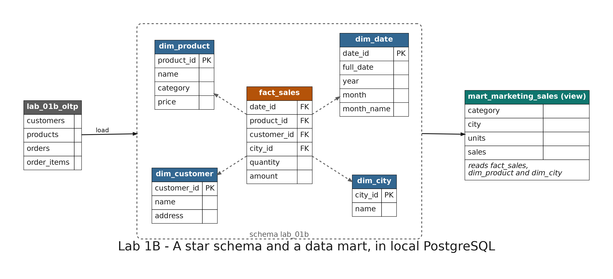

# README

- [README](#readme)
  - [Summary](#summary)
  - [Setup](#setup)
    - [Prerequisites](#prerequisites)
    - [Running the scripts](#running-the-scripts)
    - [Step 1: The transactional source](#step-1-the-transactional-source)
    - [Step 2: Create the star schema](#step-2-create-the-star-schema)
    - [Step 3: Load the warehouse](#step-3-load-the-warehouse)
    - [Step 4: Sales by category and month](#step-4-sales-by-category-and-month)
    - [Step 5: A data mart for marketing](#step-5-a-data-mart-for-marketing)
  - [Remove](#remove)

---

## Summary

`Lab 1B: star schema and data mart` builds the warehouse of the online store. You create a fact table with four dimensions, load them from the transactional tables, answer "sales by category and month" with two `JOIN`s, and give the marketing team a data mart.

It runs on the local PostgreSQL service and creates nothing in AWS. It does not depend on lab 1A: step 1 creates its own copy of the transactional tables.



---

## Setup

### Prerequisites

The development container must be running with its local services: see [Local services](../../README.md#local-services) in the root README. Open pgAdmin at <http://localhost:5050>, connect to the server `Big Data Labs` (password `example`) and open the database `shop`.

### Running the scripts

The SQL files are in `sql/` and run in order, one per step. The transactional tables live in the schema `lab_01b_oltp` and the warehouse in the schema `lab_01b`. Every table name starts with its schema.

With pgAdmin, right-click the database `shop` and choose **Query Tool**. Copy the file from Visual Studio Code and paste it in the Query Tool. Highlight the block you want to run and click **Execute script** (or press **F5**): pgAdmin runs only the highlighted text. Files with several blocks run one block at a time.

With `psql`, from the terminal of the development container, in the repository folder:

```bash
psql -f labs/01b-star-schema/sql/01_oltp_source.sql
```

### Step 1: The transactional source

Run `01_oltp_source.sql`. It creates the four tables of the store (`customers`, `products`, `orders` and `order_items`) with the same data as lab 1A.

Expected: 3 customers, 4 products, 5 orders and 6 order items.

### Step 2: Create the star schema

Run `02_star_schema.sql`. It creates the fact table `fact_sales` and its four dimensions: `dim_customer`, `dim_product`, `dim_city` and `dim_date`. The grain of the fact table is one row per order line.

Expected: a list of the 20 columns of the five tables.

To see the model as a diagram, right-click the schema `lab_01b` in pgAdmin (`Servers > Big Data Labs > Databases > shop > Schemas`) and choose **ERD For Schema**. If the schema does not appear, right-click `Schemas` and choose **Refresh**. The fact table is in the center, linked to the four dimensions.

### Step 3: Load the warehouse

Run `03_load.sql`. It copies the data from the transactional tables into the dimensions and builds one row of `fact_sales` for each order line. The city comes from the last part of the address, and the amount of each line is `quantity * price`.

Expected: 3 customers, 4 products, 3 cities, 5 dates and 6 sales.

### Step 4: Sales by category and month

Run `04_query.sql` block by block.

- **Block 1:** sales by category and month on the star schema, joining the fact table with two dimensions. Expected: Accessories 260000, Footwear 150000 and Clothing 90000, all in September 2026.
- **Block 2:** the same question on the transactional tables. Expected: the same three rows, so the load lost nothing.

### Step 5: A data mart for marketing

Run `05_data_mart.sql` block by block.

- **Block 1:** creates the view `mart_marketing_sales`, with the units and sales by category and city.
- **Block 2:** queries the data mart with no `JOIN`. Expected: 5 rows, the first one Accessories in Bogotá with 155000.

---

## Remove

Run `99_cleanup.sql`, or these statements:

```sql
DROP SCHEMA lab_01b CASCADE;
DROP SCHEMA lab_01b_oltp CASCADE;
```
