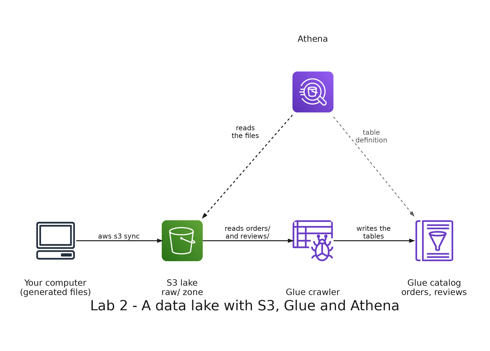

# README

- [README](#readme)
  - [Summary](#summary)
  - [Setup](#setup)
    - [Prerequisites](#prerequisites)
    - [Step 1: Deploy the base stack](#step-1-deploy-the-base-stack)
    - [Step 2: Generate the data](#step-2-generate-the-data)
    - [Step 3: Upload the data to the lake](#step-3-upload-the-data-to-the-lake)
    - [Step 4: Catalog the data with a crawler](#step-4-catalog-the-data-with-a-crawler)
    - [Step 5: Query the lake with Athena](#step-5-query-the-lake-with-athena)
    - [Step 6: Create a data swamp](#step-6-create-a-data-swamp)
    - [Step 7: Clean the swamp](#step-7-clean-the-swamp)
  - [Remove](#remove)

---

## Summary

`Lab 2: data lake` builds a data lake on AWS. You store the orders (CSV), the reviews (JSON) and the product photos in Amazon S3, let an AWS Glue crawler describe them in a catalog, and query them with Amazon Athena. Then you add a file with other columns and see what a lake without rules does.

The base stack you deploy in step 1 (an S3 bucket, a Glue database and an Athena workgroup) is also used by labs 3 and 4.



---

## Setup

### Prerequisites

The development container must be running, with your credentials in `.envs/aws.env` and `.envs/sls.env`: see [Environment variables](../../README.md#environment-variables) in the root README. The stacks deploy to the region `us-east-1`, so set `AWS_DEFAULT_REGION=us-east-1` in `.envs/aws.env`.

All the commands run in the terminal of the development container, in the repository folder. Check your credentials:

```bash
aws sts get-caller-identity
```

Expected: your AWS account id.

### Step 1: Deploy the base stack

```bash
(cd labs/shared/serverless/base && serverless deploy)
```

It creates the stack `big-data-labs-base`: an S3 bucket, a Glue database called `big_data_labs` and an Athena workgroup called `big-data-labs`. Store the name of the bucket in a variable:

```bash
BUCKET=$(aws ssm get-parameter --name /big-data-labs-base/LakeBucketName --query Parameter.Value --output text)
echo $BUCKET
```

Expected: `big-data-labs-lake-` followed by your account id.

### Step 2: Generate the data

```bash
python labs/shared/generator/generate_data.py
```

Expected: 200000 orders with 374017 lines, 50000 reviews, 14 images and 2000 swamp rows. The files are in `labs/shared/output/`: CSV files of orders, JSON files of reviews with one review per line, and one PNG per product.

### Step 3: Upload the data to the lake

```bash
aws s3 sync labs/shared/output/orders s3://$BUCKET/raw/orders/
aws s3 sync labs/shared/output/reviews s3://$BUCKET/raw/reviews/
aws s3 sync labs/shared/output/photos s3://$BUCKET/raw/photos/
```

The `raw/` zone keeps the data as it arrives, one folder per kind of data. Check it:

```bash
aws s3 ls s3://$BUCKET/raw/ --recursive --human-readable --summarize
```

Expected: 21 objects: 3 CSV files, 4 JSON files and 14 PNG files, about 40 MiB in total.

### Step 4: Catalog the data with a crawler

```bash
(cd labs/02-data-lake/serverless/crawler && serverless deploy)
aws glue start-crawler --name big-data-labs-lab02-crawler
```

The crawler reads the folders `raw/orders/` and `raw/reviews/`, and writes one table for each one in the Glue database. Wait until it finishes:

```bash
aws glue get-crawler --name big-data-labs-lab02-crawler --query Crawler.State --output text
```

Expected: `RUNNING`, and after one or two minutes `READY`. Then list the tables:

```bash
aws glue get-tables --database-name big_data_labs --query 'TableList[].Name' --output text
```

Expected: `orders` and `reviews`. The photos have no table: a crawler describes data with columns, and an image has none.

### Step 5: Query the lake with Athena

Open the Athena console in the region N. Virginia (`us-east-1`): <https://console.aws.amazon.com/athena/>. In the query editor, choose the workgroup `big-data-labs` (top right) and the database `big_data_labs`. Copy the files in `queries/` from Visual Studio Code and paste them in the editor. Highlight the statement you want to run and click **Run**.

- **`01_explore.sql`:** the tables and the orders. Expected: the tables `orders` and `reviews`, and 374017 order lines in 200000 orders.
- **`02_sales.sql`:** sales by category and month, and sales by city. Expected: 9 rows for the first query, 3 categories in each of the 3 months. In July, Footwear sells 10565210000, Accessories 10264550000 and Clothing 7359740000.
- **`03_reviews.sql`:** the reviews. Expected: 50000 reviews with an average rating of 3.87, six tags in the third statement, and 7 cities in the fourth, whose reviews add up to 50000.
- **`04_swamp.sql`:** the tables, the columns and the number of rows of `orders`. Expected: the 11 columns of the CSV files, 374017 rows, and no rows in the last statement. Keep this result: you compare it in step 6.

### Step 6: Create a data swamp

The file `labs/shared/output/swamp/orders_branch_b.csv` has orders from another branch of the store, with other names for the columns and in another order. Upload it to the same folder as the other orders and run the crawler again:

```bash
aws s3 cp labs/shared/output/swamp/orders_branch_b.csv s3://$BUCKET/raw/orders/
aws glue start-crawler --name big-data-labs-lab02-crawler
```

Wait until the crawler is `READY` again, as in step 4, and list the tables. Then run `04_swamp.sql` in Athena again, and `02_sales.sql` once more.

Expected:

- The crawler succeeds and the catalog does not change: the tables are still `orders` and `reviews`, and `orders` has the same 11 columns.
- `orders` has 376017 rows, 2000 more than before, and 202000 different orders.
- The new rows are the ones whose `order_id` starts at 900000 (statement 5). Their values are in the wrong columns and most columns are empty.
- The first statement of `02_sales.sql` now fails with `Value cannot be cast to date: 21/09/2026`.

A CSV table in Athena reads each line by position, not by column name: the first column of every file is `order_id`, the second is `order_date`, and so on. The new file has 6 columns instead of 11, so the last 5 are empty. A value that cannot be converted to the type of its column, such as a name where a number is expected, is also left empty. Nothing raises an error until a query needs the value.

### Step 7: Clean the swamp

Delete the file from the lake:

```bash
aws s3 rm s3://$BUCKET/raw/orders/orders_branch_b.csv
```

Run `04_swamp.sql` again. Expected: 374017 rows.

---

## Remove

Remove the crawler stack. `serverless remove` leaves its deployment bucket behind, empty, so delete it too:

```bash
(cd labs/02-data-lake/serverless/crawler && serverless remove)
ACCOUNT=$(aws sts get-caller-identity --query Account --output text)
aws s3 rb s3://us-east-1.cfn.lab02-crawler.big-data-labs.$ACCOUNT.deploys
```

The tables `orders` and `reviews` stay in the Glue database until you remove the base stack.

Keep the base stack while you do labs 3 and 4. When you finish them, empty the lake bucket (CloudFormation cannot delete a bucket that has objects), remove the stack and delete its deployment bucket:

```bash
BUCKET=$(aws ssm get-parameter --name /big-data-labs-base/LakeBucketName --query Parameter.Value --output text)
ACCOUNT=$(aws sts get-caller-identity --query Account --output text)
aws s3 rm s3://$BUCKET --recursive
(cd labs/shared/serverless/base && serverless remove)
aws s3 rb s3://us-east-1.cfn.base.big-data-labs.$ACCOUNT.deploys
```
