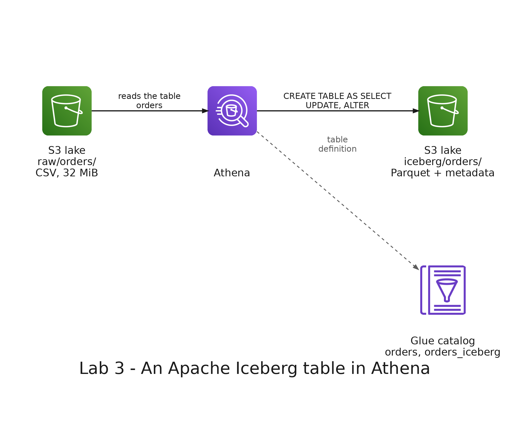

# README

- [README](#readme)
  - [Summary](#summary)
  - [Setup](#setup)
    - [Prerequisites](#prerequisites)
    - [Running the queries](#running-the-queries)
    - [Step 1: Create the Iceberg table](#step-1-create-the-iceberg-table)
    - [Step 2: Look inside the table](#step-2-look-inside-the-table)
    - [Step 3: Correct an order](#step-3-correct-an-order)
    - [Step 4: Query a previous version](#step-4-query-a-previous-version)
    - [Step 5: Add a column](#step-5-add-a-column)
  - [Remove](#remove)

---

## Summary

`Lab 3: Apache Iceberg table` turns the table of orders of lab 2 into an Apache Iceberg table in Amazon Athena. You correct an order with `UPDATE`, query the table as it was before the correction, and add a column without rewriting the data.

It uses the base stack of lab 2 and deploys nothing new.



---

## Setup

### Prerequisites

The base stack of lab 2 must be deployed, with the table `orders` in the Glue database `big_data_labs`. In the terminal of the development container, get the name of your bucket:

```bash
BUCKET=$(aws ssm get-parameter --name /big-data-labs-base/LakeBucketName --query Parameter.Value --output text)
echo $BUCKET
```

Open the Athena console in the region N. Virginia (`us-east-1`): <https://console.aws.amazon.com/athena/>. Choose the workgroup `big-data-labs` (top right) and the database `big_data_labs`, and run:

```sql
SHOW TABLES;
```

Expected: the tables `orders` and `reviews`. If they are not there, do steps 1 to 4 of lab 2 first.

### Running the queries

Each step has a file in `queries/`. Copy its content from Visual Studio Code and paste it in the Athena editor. Highlight the statement you want to run and click **Run**. Where a file has a placeholder, such as `YOUR_BUCKET`, replace it in the editor after pasting.

### Step 1: Create the Iceberg table

Paste `01_create_table.sql` and replace `YOUR_BUCKET` with the name of your bucket. The second statement, a `CREATE TABLE AS SELECT`, creates `orders_iceberg` in `s3://YOUR_BUCKET/iceberg/orders/`, as Parquet files, with the same rows as `orders` and the date as a `date`.

Expected: 374017 rows in `orders` and in `orders_iceberg`. In the lake, the folder `iceberg/orders/` has the data files and the metadata of the table:

```bash
aws s3 ls s3://$BUCKET/iceberg/orders/
```

The rows of `orders_iceberg` are stored in Apache Parquet, a columnar file format: it keeps together the values of each column, instead of line by line. A query reads only the columns it needs, and the values of a column compress well because they have the same type and repeat a lot. The schema (the names and types of the columns) is stored inside the file. Compare the size of the Parquet file with the CSV files it came from:

```bash
aws s3 ls s3://$BUCKET/iceberg/orders/data/ --human-readable
aws s3 ls s3://$BUCKET/raw/orders/ --human-readable
```

Expected: one Parquet file of about 2.9 MiB, and three CSV files of about 32 MiB in total.

### Step 2: Look inside the table

Run `02_inspect.sql` block by block. Iceberg keeps its own metadata, and Athena shows it as tables whose name ends in `$snapshots`, `$files` and `$history`.

- **Block 1, snapshots:** the versions of the table. Expected: one row.
- **Block 2, files:** the files that form the table now. Expected: only data files (`content` 0), and their `record_count` adds up to 374017.
- **Block 3, history:** when each version became the current one.

### Step 3: Correct an order

Run `03_update.sql` block by block. The customer of order 10482 asks for 3 T-shirts instead of 2.

- **Block 1:** the order before the correction. Expected: a T-shirt with quantity 2 and amount 60000, and a Cap with quantity 1 and amount 35000.
- **Block 2:** the `UPDATE`.
- **Block 3:** the order after the correction. Expected: the T-shirt with quantity 3 and amount 90000.
- **Block 4, snapshots:** the versions of the table and the files each one added. Expected: two rows. The first is an `append` that added 1 data file. The second is an `overwrite` that added 1 data file and 1 file of deletes.
- **Block 5, files:** the data files of the table. Expected: two files, the original one with 374017 records and a new one with 1 record, the corrected row.

`UPDATE` does not edit the Parquet file. It writes a file of deletes that marks the old row as deleted, and a data file with the corrected row. A query combines them when it reads. The file of deletes is not listed in `$files`, but it is in the lake:

```bash
aws s3 ls s3://$BUCKET/iceberg/orders/data/ --recursive --human-readable
```

Expected: three Parquet files: the original one of 2.9 MiB, and two of a few KiB at most, the corrected row and the file of deletes.

### Step 4: Query a previous version

In `04_time_travel.sql`, run block 1 first. Then replace `FIRST_SNAPSHOT_ID` and `FIRST_COMMITTED_AT` in the other blocks with the values of the oldest row of block 1.

- **Block 2, by version:** Expected: the T-shirt of order 10482 with quantity 2 and amount 60000.
- **Block 3, by time:** the same result, asking for the table as of a moment.
- **Block 4:** the order now. Expected: quantity 3 and amount 90000.

### Step 5: Add a column

Run `05_add_column.sql` block by block. The store wants to know the channel of each order.

- **Block 1:** adds the column `channel`. It only changes the metadata: no data file is rewritten.
- **Block 2:** Expected: `channel` is empty in the old rows.
- **Block 3:** gives the channel `web` to order 10482.
- **Block 4:** inserts a new order with the channel `app`.
- **Block 5:** Expected: 374015 rows with no channel, 2 rows with `web` and 1 row with `app`.

---

## Remove

Run `06_drop_table.sql`, or this statement:

```sql
DROP TABLE orders_iceberg;
```

Dropping an Iceberg table also removes its data. Check it:

```bash
aws s3 ls s3://$BUCKET/iceberg/orders/ --recursive
```

Expected: no objects. Keep the base stack for lab 4.
