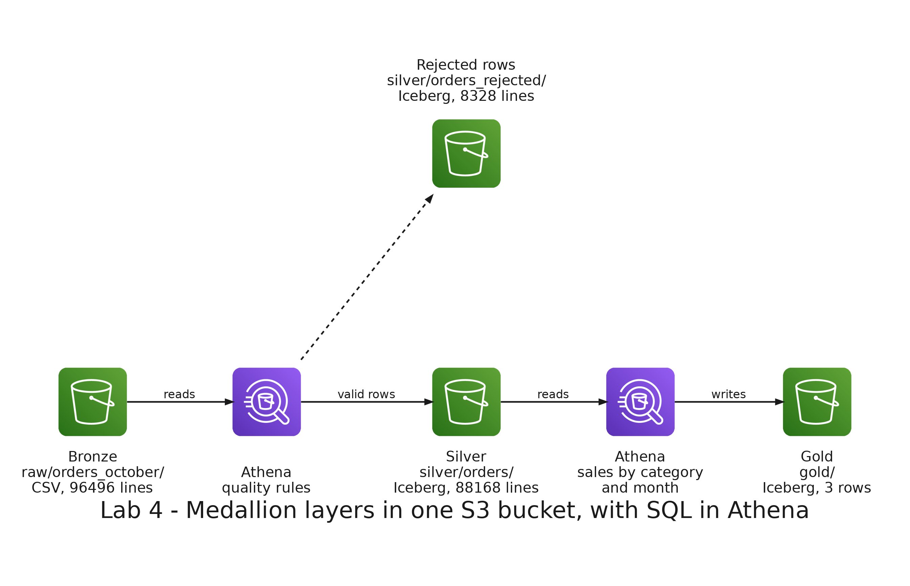

# README

- [README](#readme)
  - [Summary](#summary)
  - [Setup](#setup)
    - [Prerequisites](#prerequisites)
    - [Running the queries](#running-the-queries)
    - [Step 1: Upload the batch of orders](#step-1-upload-the-batch-of-orders)
    - [Step 2: Bronze, the data as it arrived](#step-2-bronze-the-data-as-it-arrived)
    - [Step 3: Silver, clean and validated](#step-3-silver-clean-and-validated)
    - [Step 4: Gold, ready for the analytics](#step-4-gold-ready-for-the-analytics)
    - [Step 5: Compare the layers](#step-5-compare-the-layers)
  - [Remove](#remove)

---

## Summary

`Lab 4: medallion layers` builds the bronze, silver and gold layers of a batch of orders that arrives with the defects of real data: repeated lines, invalid dates, quantities that make no sense, amounts that do not match and orders with no customer. You use only SQL in Amazon Athena, and compare how much data each layer scans to answer the same question.

It uses the base stack of lab 2 and deploys nothing new. In the bucket, `raw/` is the bronze layer, and the lab adds the folders `silver/` and `gold/`.



---

## Setup

### Prerequisites

The base stack of lab 2 must be deployed. In the terminal of the development container, get the name of your bucket:

```bash
BUCKET=$(aws ssm get-parameter --name /big-data-labs-base/LakeBucketName --query Parameter.Value --output text)
echo $BUCKET
```

Open the Athena console in the region N. Virginia (`us-east-1`): <https://console.aws.amazon.com/athena/>. Choose the workgroup `big-data-labs` and the database `big_data_labs`.

### Running the queries

Each step has a file in `queries/`. Copy its content from Visual Studio Code and paste it in the Athena editor. Highlight the statement you want to run and click **Run**. Where a file has a placeholder, such as `YOUR_BUCKET`, replace it in the editor after pasting.

### Step 1: Upload the batch of orders

The generator of lab 2 also writes the batch of October, in `labs/shared/output/orders_october/`. If that folder does not exist, run the generator again:

```bash
python labs/shared/generator/generate_data.py
```

Expected: the generator prints the batch of October, 50000 orders in 96496 lines, and how many lines have each defect.

Upload the batch to the lake:

```bash
aws s3 sync labs/shared/output/orders_october s3://$BUCKET/raw/orders_october/
```

Expected: the folder `raw/orders_october/` has one CSV file of about 8.4 MiB:

```bash
aws s3 ls s3://$BUCKET/raw/orders_october/ --human-readable
```

### Step 2: Bronze, the data as it arrived

Run `01_bronze.sql` block by block. Replace `YOUR_BUCKET` first. The bronze table reads the file as it is and keeps every column as text, so nothing is rejected or changed on the way in.

- **Block 1:** creates the table `bronze_orders` over the folder `raw/orders_october/`.
- **Block 2:** Expected: 96496 lines.
- **Block 3:** the first lines.
- **Block 4:** Expected: 2772 pairs of order and product that appear more than once.
- **Block 5:** Expected: three invalid values for the date: an empty one in 319 lines, `2026-10-32` in 313 and `31/10/2026` in 282.
- **Block 6:** Expected: the quantities -1 in 326 lines, -2 in 287 and 0 in 327.
- **Block 7:** Expected: 1887 lines with no customer.
- **Block 8:** Expected: 1815 lines whose amount is not the quantity times the unit price.

### Step 3: Silver, clean and validated

Run `02_silver.sql` block by block. Replace `YOUR_BUCKET` first.

- **Block 1:** creates a view with the rules of quality. A view stores no data: each line of bronze gets a `reject_reason`, or none if it passes every rule.
- **Block 2:** what happens to the 96496 lines. Expected: 88168 valid, 2772 duplicate, 1887 missing_customer, 1815 amount_mismatch, 940 invalid_quantity and 914 invalid_date.
- **Block 3:** creates the Iceberg table `silver_orders` with the valid lines, with their real types.
- **Block 4:** creates the Iceberg table `silver_orders_rejected` with the other lines and the reason.
- **Block 5:** Expected: 88168 lines in `silver_orders` and 8328 in `silver_orders_rejected`. Together they are the 96496 lines of bronze.
- **Block 6:** the reasons of the rejected lines, with the counts of block 2.

### Step 4: Gold, ready for the analytics

Run `03_gold.sql` block by block. Replace `YOUR_BUCKET` first.

- **Block 1:** creates the table `gold_sales_by_category_month` from the silver layer, with one row for each category and month.
- **Block 2:** Expected: 3 rows, all of October 2026: Footwear 7389850000, Accessories 7223715000 and Clothing 5184280000.

### Step 5: Compare the layers

Run `04_compare.sql` block by block. After each one, look at the data scanned that Athena shows next to the result.

- **Block 1, bronze:** the sales of each category with no rules of quality. Expected: Footwear 7963715000, Accessories 7792991000 and Clothing 5574122000. They are higher than the real ones because the repeated lines and the wrong amounts are counted. Data scanned: 8774361 bytes, the whole CSV file.
- **Block 2, silver:** Expected: the same numbers as the gold table. Data scanned: about 73 KB, because Parquet reads only the columns the query needs and the file is smaller.
- **Block 3, gold:** the same numbers, reading a table of 3 rows. Data scanned: 135 bytes.

---

## Remove

Run `05_drop.sql` block by block. Dropping the Iceberg tables removes their data. Dropping `bronze_orders` does not, so delete the batch of orders from the lake:

```bash
aws s3 rm s3://$BUCKET/raw/orders_october/ --recursive
```

These are the last labs that use the base stack. To remove everything that labs 2, 3 and 4 created, empty the bucket (CloudFormation cannot delete a bucket that has objects), remove the stack and delete its deployment bucket. If the crawler stack of lab 2 is still deployed, remove it first, as lab 2 explains.

```bash
ACCOUNT=$(aws sts get-caller-identity --query Account --output text)
aws s3 rm s3://$BUCKET --recursive
(cd labs/shared/serverless/base && serverless remove)
aws s3 rb s3://us-east-1.cfn.base.big-data-labs.$ACCOUNT.deploys
```
