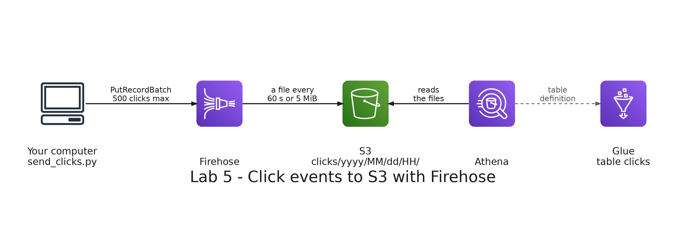

# README

- [README](#readme)
  - [Summary](#summary)
  - [Setup](#setup)
    - [Prerequisites](#prerequisites)
    - [Step 1: Deploy the stack](#step-1-deploy-the-stack)
    - [Step 2: Send the clicks](#step-2-send-the-clicks)
    - [Step 3: Watch the batches arrive](#step-3-watch-the-batches-arrive)
    - [Step 4: Create the table](#step-4-create-the-table)
    - [Step 5: Query the clicks](#step-5-query-the-clicks)
    - [Step 6: Look at the batches](#step-6-look-at-the-batches)
  - [Remove](#remove)

---

## Summary

`Lab 5: clicks in real time with Firehose` streams the clicks of the online store to Amazon S3. A Python program sends the events to Amazon Data Firehose as they happen, Firehose delivers them to S3 in batches, and you query them with Amazon Athena.

It has its own stack, with its own bucket, Glue database and Athena workgroup, and does not need the stacks of the other labs.



---

## Setup

### Prerequisites

The development container must be running, with your credentials in `.envs/aws.env` and `.envs/sls.env`: see [Environment variables](../../README.md#environment-variables) in the root README. The stack deploys to the region `us-east-1`, so set `AWS_DEFAULT_REGION=us-east-1` in `.envs/aws.env`.

This lab needs the paid plan of your AWS account: Amazon Data Firehose is not available in the free plan. If your account is on the free plan, open the Billing console, choose **Upgrade plan** and then **Upgrade account**: <https://console.aws.amazon.com/billing/home#/freetier/upgrade>. The credits you have left stay in your account, and from then on you pay the standard price for what you use beyond them. Check that Firehose is available:

```bash
aws firehose list-delivery-streams
```

Expected: a list with no delivery streams, `"DeliveryStreamNames": []`, and not the error `The AWS Access Key Id needs a subscription for the service`.

All the commands run in the terminal of the development container, in the repository folder. Get the name of the bucket the stack will create:

```bash
ACCOUNT=$(aws sts get-caller-identity --query Account --output text)
BUCKET=big-data-labs-clicks-$ACCOUNT
echo $BUCKET
```

### Step 1: Deploy the stack

```bash
(cd labs/05-firehose/serverless/clicks && serverless deploy)
```

It creates the stack `big-data-labs-lab05-clicks`: the S3 bucket, a Glue database called `big_data_labs_clicks`, an Athena workgroup called `big-data-labs-clicks` and a Firehose stream called `big-data-labs-clicks`. Check the stream:

```bash
aws firehose describe-delivery-stream --delivery-stream-name big-data-labs-clicks --query DeliveryStreamDescription.DeliveryStreamStatus --output text
```

Expected: `ACTIVE`.

### Step 2: Send the clicks

```bash
python labs/05-firehose/producer/send_clicks.py
```

The program sends 200 clicks per second for 5 minutes, 60000 in total, with `PutRecordBatch`. Each click is a JSON line with the type of event (`page_view`, `search`, `add_to_cart` or `purchase`), the product, the device and, when the visitor is signed in, the customer.

Expected: a line every 10 seconds, and at the end `300s: 60000 events sent, 0 failed`.

To see how a click looks without sending anything, run it with `--dry-run --rate 3`.

### Step 3: Watch the batches arrive

While the program runs, open a second terminal and list the bucket every minute or so:

```bash
aws s3 ls s3://$BUCKET/clicks/ --recursive --human-readable
```

Firehose does not write each click: it keeps them in a buffer and delivers a file when the buffer is full or a time has passed. This stream delivers every 60 seconds or 5 MiB, whichever happens first, so new files appear while the program runs. The files are in folders by the UTC date and hour, such as `clicks/2026/10/10/21/`.

### Step 4: Create the table

Open the Athena console in the region N. Virginia (`us-east-1`): <https://console.aws.amazon.com/athena/>. Choose the workgroup `big-data-labs-clicks` and the database `big_data_labs_clicks`.

Copy `queries/01_clicks_table.sql` from Visual Studio Code and paste it in the editor. Replace `YOUR_BUCKET` in the two places where it appears, highlight the statement and click **Run**. The table finds the folders of Firehose by itself, with partition projection, so you do not need to register them as they arrive.

### Step 5: Query the clicks

Wait until the program finishes and one more minute for the last batch. Copy the files `02_explore.sql` and `03_funnel.sql`, highlight a statement and click **Run**.

- **`02_explore.sql`, block 1:** Expected: 60000 clicks.
- **`02_explore.sql`, block 3:** Expected: page_view 42156, search 8823, add_to_cart 6003 and purchase 3018.
- **`02_explore.sql`, block 4:** the clicks by minute. Expected: about 12000 for each complete minute.
- **`03_funnel.sql`, block 1:** the funnel of each category. Expected: Footwear 11992 page views, 1717 added to the cart and 914 purchases (7.62 percent), Accessories 18324, 2635 and 1264 (6.9 percent) and Clothing 11840, 1651 and 840 (7.09 percent).
- **`03_funnel.sql`, block 2:** Expected: sales of Footwear 259390000, Accessories 242805000 and Clothing 176070000.
- **`03_funnel.sql`, block 3:** Expected: 18174 clicks of visitors who were not signed in.

### Step 6: Look at the batches

Run `04_batches.sql`. It shows one row for each file Firehose delivered, with the number of clicks it holds and the time of its first and last click. Expected: the clicks of all the files add up to 60000.

---

## Remove

The stack owns the bucket, and CloudFormation cannot delete a bucket that has objects. Empty it, remove the stack and delete its deployment bucket:

```bash
aws s3 rm s3://$BUCKET --recursive
(cd labs/05-firehose/serverless/clicks && serverless remove)
aws s3 rb s3://us-east-1.cfn.lab05-clicks.big-data-labs.$ACCOUNT.deploys
```

If the variables `BUCKET` or `ACCOUNT` are empty, define them again as in the prerequisites.
