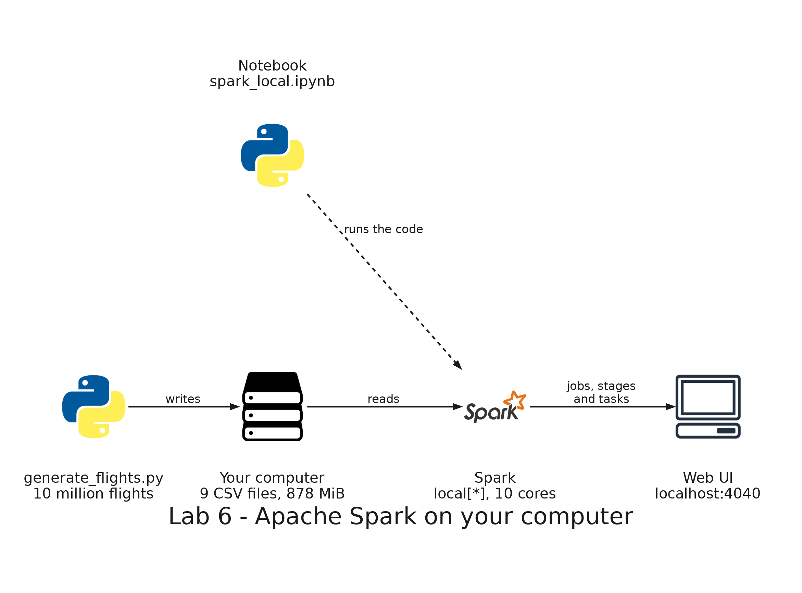

# README

- [README](#readme)
  - [Summary](#summary)
  - [Setup](#setup)
    - [Prerequisites](#prerequisites)
    - [Step 1: Generate the flights](#step-1-generate-the-flights)
    - [Step 2: Open the notebook and start Spark](#step-2-open-the-notebook-and-start-spark)
    - [Step 3: Read the flights](#step-3-read-the-flights)
    - [Step 4: Actions and lazy transformations](#step-4-actions-and-lazy-transformations)
    - [Step 5: Partitions, stages and the shuffle](#step-5-partitions-stages-and-the-shuffle)
    - [Step 6: The same query in Spark SQL](#step-6-the-same-query-in-spark-sql)
    - [Step 7: A join with a small table](#step-7-a-join-with-a-small-table)
    - [Step 8: A window function](#step-8-a-window-function)
    - [Step 9: Spark and pandas](#step-9-spark-and-pandas)
  - [Remove](#remove)

---

## Summary

`Lab 6: Spark on your computer` runs Apache Spark inside the development container, on the flights of an airline: about 10 million flights in nine monthly CSV files, plus three small tables of airports, airlines and aircraft. You read the flights, see that transformations are lazy, follow a query through its jobs, stages and tasks in the web UI of Spark, write the same query in Spark SQL, join the flights with a small table, use a window function, and compare Spark with pandas on the same calculation.

It runs only on your computer: it needs no AWS account and deploys nothing.



---

## Setup

### Prerequisites

The development container needs Java 17, PySpark, pandas and the Jupyter kernel, which the image of the repository installs. If you created the container before this lab, rebuild it: in Visual Studio Code, open the Command Palette and run `Dev Containers: Rebuild Container`.

In the terminal of the development container, check Java:

```bash
java -version
```

Expected: the first line is `openjdk version "17.0.20.1"` or another Java 17 version.

Spark and the flights need memory. In Docker Desktop, open **Settings**, then **Resources**, and give Docker at least 6 GB.

### Step 1: Generate the flights

```bash
python3 labs/shared/generator/generate_flights.py
```

Expected: after about 20 seconds, the generator prints `Wrote 10000000 flights to` followed by the path of `labs/shared/output`. The folder has four folders:

- `flights/`: nine CSV files, one per month from January to September 2026, about 880 MB in total.
- `airports/`: `airports.csv`, with 20 airports.
- `airlines/`: `airlines.csv`, with 8 airlines.
- `aircraft/`: `aircraft.csv`, with about 6100 aircraft.

The generator takes `--flights` to change the number of flights, for example `--flights 2000000` on a computer with little memory.

### Step 2: Open the notebook and start Spark

In Visual Studio Code, open `labs/06-spark-local/spark_local.ipynb`. If it asks for a kernel, choose **Python Environments** and then `/usr/local/bin/python`, the Python 3.13 of the container. Run the cells one at a time, from the top.

Run the first code cell, which starts Spark on all the cores of the container.

Expected: Spark prints a few warning lines, about incubator modules and the native Hadoop library, which are normal. The cell ends with the number of cores, for example `10`. Open <http://localhost:4040> in your browser: it is the web UI of Spark. The Jobs tab is empty. The UI exists only while the Spark session is open.

### Step 3: Read the flights

Run the cell that reads the flights. It gives the schema explicitly.

Expected: the schema has 11 columns, from `flight_id` to `cancelled`, and the cell ends with `11`, the number of partitions. The Jobs tab is still empty: reading ran no job.

### Step 4: Actions and lazy transformations

Run the cell with `flights.count()`.

Expected: `10000000`. The Jobs tab shows one job with two stages, one of 11 tasks and one of 1 task.

Run the cell that defines `flown` and `late`.

Expected: the cell finishes at once and the Jobs tab shows no new job. These lines only note the plan.

Run `late.count()`.

Expected: `2885600`, the flights that left more than 15 minutes late. The Jobs tab shows one new job with two stages, of 11 and 1 tasks.

### Step 5: Partitions, stages and the shuffle

Run the cell that groups the flights by origin.

Expected: the plan has four steps, from the bottom:

- `FileScan csv`: reads the CSV files. It reads only the column `origin`, the one the query needs.
- `HashAggregate` with `partial_count(1)`: each task counts, in its own partition, the flights of each origin.
- `Exchange hashpartitioning(origin, 200)`: the shuffle. Spark computes a number from the origin and uses it to choose one of 200 partitions, so all the partial counts of an origin arrive at the same partition.
- `HashAggregate` with `count(1)`: adds the partial counts of each origin.

The table shows the five origins with more flights:

| origin | count   |
| ------ | ------- |
| BOG    | 2382869 |
| MDE    | 1662523 |
| CTG    | 1185446 |
| CLO    | 1184654 |
| BAQ    | 729500  |

In the Jobs tab, open the new job. It has two stages: the first has 11 tasks, one for each partition of the flights, and the second has 200 tasks, one for each partition after the shuffle.

### Step 6: The same query in Spark SQL

Run the cell that registers the flights as a view and runs the query with `spark.sql`.

Expected: the plan is the same as in step 5, and the table of the five origins is the same too.

### Step 7: A join with a small table

Run the cell that joins the flights with the airports.

Expected: the plan has a `BroadcastHashJoin` and a `BroadcastExchange` of the airports. The flights are not moved to join them. The table of flights by country of origin:

| country       | count   |
| ------------- | ------- |
| Colombia      | 9082550 |
| United States | 294507  |
| Panama        | 130287  |
| Spain         | 98388   |
| Peru          | 98014   |
| Mexico        | 97787   |
| Chile         | 66409   |
| Brazil        | 66107   |
| Argentina     | 65951   |

### Step 8: A window function

Run the cell with the window function. It adds the delay minutes of each day to the total of the previous days of the same airline.

Expected: the first five days of the airline `AND`:

| airline_code | flight_date | delay_min_total | running_delay_min |
| ------------ | ----------- | --------------- | ----------------- |
| AND          | 2026-01-01  | 85089.0         | 85089.0           |
| AND          | 2026-01-02  | 81846.0         | 166935.0          |
| AND          | 2026-01-03  | 82338.0         | 249273.0          |
| AND          | 2026-01-04  | 85251.0         | 334524.0          |
| AND          | 2026-01-05  | 79547.0         | 414071.0          |

### Step 9: Spark and pandas

Run the two cells of the comparison. Both read all the files and compute the average delay of each airline.

Expected: both give the same averages:

| airline_code | avg_delay_min |
| ------------ | ------------- |
| AND          | 9.78          |
| CAR          | 29.39         |
| CEN          | 8.59          |
| LLA          | 33.53         |
| NOR          | 17.69         |
| ORI          | 21.59         |
| PAC          | 6.10          |
| SUR          | 41.40         |

The times depend on your computer. On a computer with 10 cores, Spark takes about 1 second and pandas about 7 seconds.

---

## Remove

Run the last cell of the notebook, `spark.stop()`. The web UI at <http://localhost:4040> stops answering.

Delete the generated files:

```bash
rm -rf labs/shared/output/flights labs/shared/output/airports labs/shared/output/airlines labs/shared/output/aircraft
```
