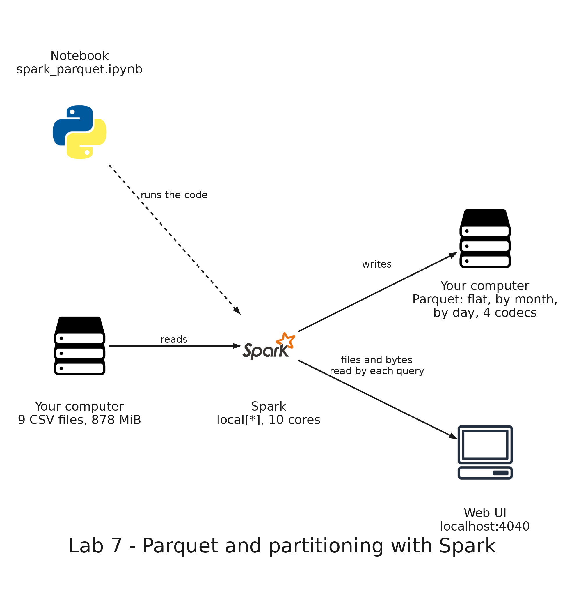

# README

- [README](#readme)
  - [Summary](#summary)
  - [Setup](#setup)
    - [Prerequisites](#prerequisites)
    - [Step 1: Generate the flights](#step-1-generate-the-flights)
    - [Step 2: Open the notebook and start Spark](#step-2-open-the-notebook-and-start-spark)
    - [Step 3: Read the flights](#step-3-read-the-flights)
    - [Step 4: Write the flights as Parquet](#step-4-write-the-flights-as-parquet)
    - [Step 5: Write the flights partitioned by month](#step-5-write-the-flights-partitioned-by-month)
    - [Step 6: Partition pruning](#step-6-partition-pruning)
    - [Step 7: Too many partitions](#step-7-too-many-partitions)
    - [Step 8: Compression](#step-8-compression)
  - [Remove](#remove)

---

## Summary

`Lab 7: Parquet and partitioning with Spark` runs Apache Spark inside the development container, on the 10 million flights of lab 6. You write the flights as Parquet, once without partitions and once with one folder for each month, and ask both copies the same question to see in the plan and in the web UI of Spark that the query on the partitioned copy reads only the folder of one month. Then you partition by day, which creates 273 folders, and compare four compression codecs.

It runs only on your computer: it needs no AWS account and deploys nothing.



---

## Setup

### Prerequisites

The same development container as lab 6: Java 17, PySpark and the Jupyter kernel. In Docker Desktop, Docker needs at least 6 GB of memory, and your computer needs about 2 GB of free disk space for the CSV and the Parquet files.

### Step 1: Generate the flights

If you still have the flights of lab 6 in `labs/shared/output/flights`, skip this step. Otherwise:

```bash
python3 labs/shared/generator/generate_flights.py
```

Expected: after about 20 seconds, the generator prints `Wrote 10000000 flights to` followed by the path of `labs/shared/output`.

### Step 2: Open the notebook and start Spark

In Visual Studio Code, open `labs/07-parquet-partitioning/spark_parquet.ipynb`. If it asks for a kernel, choose **Python Environments** and then `/usr/local/bin/python`. Run the cells one at a time, from the top.

Run the first code cell, which starts Spark on all the cores of the container.

Expected: the cell ends with the number of cores, for example `10`. Open <http://localhost:4040> in your browser: it is the web UI of Spark.

### Step 3: Read the flights

Run the cell that reads the flights and defines the helper `stats`, which counts the files of a folder and adds up their size.

Expected: `9 files, 877.8 MiB`, the nine monthly CSV files.

### Step 4: Write the flights as Parquet

Run the cell that writes the flights to `labs/shared/output/parquet/flat`.

Expected: it takes a few seconds and ends with `11 files, 147.6 MiB`. The same flights take 877.8 MiB as CSV: Parquet stores each column apart and compresses it, snappy by default. The 11 files are one for each partition of the flights.

### Step 5: Write the flights partitioned by month

Run the cell that adds the column `month` and writes with `partitionBy('month')`.

Expected: the list of folders is `month=2026-01` to `month=2026-09`, one for each month, and the totals are `17 files, 146.8 MiB`. The size is the same as the flat copy. Partitioning does not change how much the data weighs, it changes how it is arranged: each folder holds the flights of one month, in one or two files.

### Step 6: Partition pruning

Run the first cell, which counts the flights of March by airline on the partitioned copy, filtering on the column `month`.

Expected: the scan of the plan has `PartitionFilters: [isnotnull(month#47), (month#47 = 2026-03)]` and `ReadSchema: struct<airline_code:string>`. Spark reads only the folder `month=2026-03`, and only the column `airline_code`. The table shows the flights of March for each of the 8 airlines, 1,101,243 in total, for example `AND` with 241974.

Run the second cell, which asks the same on the flat copy, filtering on `flight_date`.

Expected: the same table. The scan has `PartitionFilters: []` and a `Filter` step above it: Spark has no folders to discard, so it reads every file and filters the rows afterwards.

Open the **SQL / DataFrame** tab of the web UI. The two rows on top, both `showString`, are the last two queries: the top one is the flat copy and the one below it is the partitioned copy. Click the ID of a row to open its plan, then check **Show metrics in graph nodes (detailed mode)** and zoom in with the `+` button. The first node of the plan, `Scan parquet`, lists what the query read:

| copy        | number of files read | size of files read | number of output rows |
| ----------- | -------------------- | ------------------ | --------------------- |
| partitioned | 2                    | 16.3 MiB           | 1,101,243             |
| flat        | 11                   | 147.6 MiB          | 10,000,000            |

### Step 7: Too many partitions

Run the cell that writes the flights partitioned by day.

Expected: `273 folders` and `518 files, 153.3 MiB`. There are almost 50 times more files than in the flat copy, and the total is a bit larger. The writing takes longer too: about 6 seconds against 4.5. Each folder holds only about 37,000 flights.

### Step 8: Compression

Run the cell that writes the flights with three more codecs.

`uncompressed` writes Parquet with no compression, to show how much each codec saves. It is still much smaller than the 877.8 MiB of CSV, because Parquet stores the values of each column in a binary format and not as text.

Expected: the time and the size of each copy, 11 files each. The table adds the size of the copy of step 4:

| codec        | size      |
| ------------ | --------- |
| uncompressed | 196.3 MiB |
| snappy       | 147.6 MiB |
| gzip         | 116.7 MiB |
| zstd         | 111.0 MiB |

Snappy is the one of step 4, the default of Spark. Gzip and zstd compress more, and the writing times are close to each other on this computer (3 to 4 seconds). The times depend on your computer.

---

## Remove

Run the last cell of the notebook, `spark.stop()`. The web UI at <http://localhost:4040> stops answering.

Delete the generated files:

```bash
rm -rf labs/shared/output/parquet labs/shared/output/flights labs/shared/output/airports labs/shared/output/airlines labs/shared/output/aircraft
```
