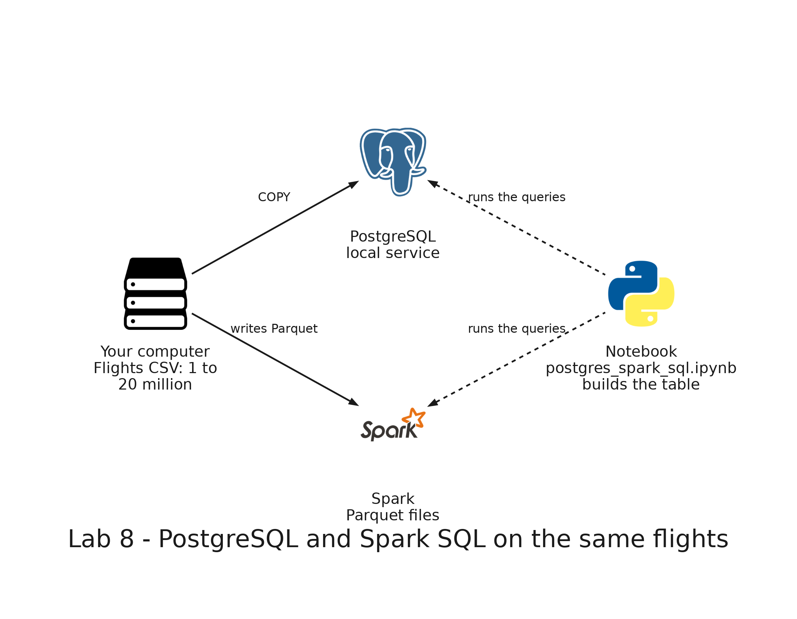

# README

- [README](#readme)
  - [Summary](#summary)
  - [Setup](#setup)
    - [Prerequisites](#prerequisites)
    - [Step 1: Check PostgreSQL](#step-1-check-postgresql)
    - [Step 2: Open the notebook and connect to both engines](#step-2-open-the-notebook-and-connect-to-both-engines)
    - [Step 3: The two queries](#step-3-the-two-queries)
    - [Step 4: The helpers](#step-4-the-helpers)
    - [Step 5: Load and measure one volume](#step-5-load-and-measure-one-volume)
    - [Step 6: Run the five volumes](#step-6-run-the-five-volumes)
    - [Step 7: Compare the analytic query](#step-7-compare-the-analytic-query)
    - [Step 8: Compare the lookup](#step-8-compare-the-lookup)
    - [Step 9: Compare the loads](#step-9-compare-the-loads)
    - [Step 10: The plans](#step-10-the-plans)
  - [Remove](#remove)

---

## Summary

`Lab 8: PostgreSQL and Spark SQL on the same flights` runs the same two queries in PostgreSQL and in Spark SQL, on 1, 5, 10, 15 and 20 million flights. The analytic query counts the flights of each airline and the ones that left more than 15 minutes late. The lookup finds one flight by its `flight_id`. One notebook loads the flights into both engines, times the queries and builds the comparison tables, so you can follow how each number is calculated.

It runs only on your computer: it needs no AWS account and deploys nothing.



---

## Setup

### Prerequisites

The development container needs Java 17, PySpark, the Jupyter kernel and the `psycopg` driver, which the image of the repository installs, and the PostgreSQL service, which starts with the container. If you created the container before this lab, rebuild it: in Visual Studio Code, open the Command Palette and run `Dev Containers: Rebuild Container`.

In Docker Desktop, open **Settings**, then **Resources**, and give Docker at least 6 GB of memory. The lab needs about 5 GB of free disk space.

### Step 1: Check PostgreSQL

```bash
psql -c "SELECT version();"
```

Expected: one row that starts with `PostgreSQL 18`.

### Step 2: Open the notebook and connect to both engines

In Visual Studio Code, open `labs/08-postgres-spark-sql/postgres_spark_sql.ipynb`. If it asks for a kernel, choose **Python Environments** and then `/usr/local/bin/python`. Run the cells one at a time, from the top.

Run the first code cell. It connects to PostgreSQL with the variables `PGHOST`, `PGUSER`, `PGPASSWORD` and `PGDATABASE` of the container, and starts Spark on all the cores.

Expected: the cell prints the version of PostgreSQL, the version of Spark and the number of cores, for example `18.6 (Debian 18.6-1.pgdg13+2) 4.2.0 10`.

### Step 3: The two queries

Run the cell with the two queries.

Expected: it prints the analytic query and the lookup of the flight `13000000`, the one the notebook searches in the last volume. Both engines receive exactly this text.

### Step 4: The helpers

Run the cells that define `run_pg`, `run_spark` and `seconds`.

Expected: no output. `seconds` runs a query three times and keeps the median.

### Step 5: Load and measure one volume

Run the cell that defines `load_volume` and the one that defines `measure`.

Expected: no output. `load_volume` generates the CSV files of a volume, loads them into the PostgreSQL table `flights` with `COPY`, writes them as Parquet with Spark and registers the Parquet files as the view `flights`. `measure` loads a volume, checks that both engines return the same rows for the analytic query, and times the queries. For the lookup it times PostgreSQL without an index, builds the index on `flight_id`, times PostgreSQL again and times Spark.

### Step 6: Run the five volumes

Run the cell with the loop.

Expected: after about 3 minutes, it prints `1000000 flights done`, `5000000 flights done`, `10000000 flights done`, `15000000 flights done` and `20000000 flights done`. While it runs, the Spark web UI at <http://localhost:4040> lists the queries.

### Step 7: Compare the analytic query

Run the cell that builds the first table. The column `PostgreSQL / Spark SQL` divides the time of PostgreSQL by the time of Spark SQL: above 1, Spark SQL answered faster, and below 1, PostgreSQL did.

Expected, in seconds:

| flights  | PostgreSQL (s) | Spark SQL (s) | PostgreSQL / Spark SQL |
| -------- | -------------- | ------------- | ---------------------- |
| 1000000  | 0.04           | 0.26          | 0.14                   |
| 5000000  | 0.27           | 0.30          | 0.89                   |
| 10000000 | 0.52           | 0.33          | 1.58                   |
| 15000000 | 0.77           | 0.40          | 1.92                   |
| 20000000 | 1.01           | 0.54          | 1.88                   |

PostgreSQL's time grows almost in proportion to the number of flights, while the time of Spark SQL grows slowly. At 5 million flights the two engines are within a few hundredths of a second, and which one wins can change from one run to another. From 10 million flights on, Spark SQL is faster, by a factor that goes from about 1.5 to about 1.9. The times depend on your computer.

### Step 8: Compare the lookup

Run the cell that builds the second table. The ratio `without index / with index` shows how much faster PostgreSQL gets with the index, and `Spark SQL / with index` compares Spark SQL with PostgreSQL using the index.

Expected, in milliseconds:

| flights  | PostgreSQL without index | PostgreSQL with index | Spark SQL | without index / with index | Spark SQL / with index |
| -------- | ------------------------ | --------------------- | --------- | -------------------------- | ---------------------- |
| 1000000  | 10.28                    | 0.09                  | 40.48     | 111.90                     | 440.55                 |
| 5000000  | 62.46                    | 0.14                  | 49.74     | 439.58                     | 350.10                 |
| 10000000 | 110.44                   | 0.21                  | 39.03     | 537.86                     | 190.09                 |
| 15000000 | 157.66                   | 0.18                  | 37.78     | 861.56                     | 206.44                 |
| 20000000 | 203.73                   | 0.08                  | 34.07     | 2494.68                    | 417.19                 |

Without an index, PostgreSQL reads the whole table, so its time grows with the volume. With the index, it goes down a tree and reads a few pages, and the time stays at a fraction of a millisecond. Spark SQL passes the filter to the Parquet reader and takes between 34 and 50 milliseconds at every volume.

### Step 9: Compare the loads

Run the cell that builds the third table.

Expected, in seconds:

| flights  | PostgreSQL COPY (s) | PostgreSQL index (s) | Spark Parquet (s) |
| -------- | ------------------- | -------------------- | ----------------- |
| 1000000  | 0.90                | 0.09                 | 2.43              |
| 5000000  | 5.26                | 0.54                 | 1.73              |
| 10000000 | 8.40                | 1.32                 | 2.93              |
| 15000000 | 13.31               | 1.59                 | 4.94              |
| 20000000 | 17.79               | 1.98                 | 6.75              |

PostgreSQL stores every flight in its table, and its load grows with the volume. The index is extra work that PostgreSQL does once and then keeps up to date with every write.

### Step 10: The plans

Run the cells with the plans of the last volume, the one with 20 million flights.

Expected, in PostgreSQL, for the analytic query: a `Parallel Seq Scan on flights` that reads the whole table with 2 workers, followed by a `Partial HashAggregate` and a `Finalize GroupAggregate`, and an `Execution Time` of about 1.4 seconds.

For the lookup, the first plan is an `Index Scan using flights_flight_id_idx` with an `Execution Time` of about 0.03 milliseconds. After the cell drops the index, the second plan is a `Parallel Seq Scan` that removes 6,666,666 rows per worker and takes about 210 milliseconds.

In Spark SQL, the plan of the analytic query reads only the columns `airline_code`, `scheduled_departure`, `actual_departure` and `cancelled` in the `FileScan parquet`, with `PushedFilters` on `cancelled`, and has two `Exchange` steps: one to group by airline and one to sort. The plan of the lookup has `PushedFilters: [IsNotNull(flight_id), EqualTo(flight_id,13000000)]`: Spark passes the filter to the Parquet reader.

---

## Remove

Run the last cell of the notebook. It drops the table `flights`, closes the connection, stops Spark and deletes `labs/shared/output/lab08`.

If you stopped the notebook before the end, delete the generated files and the table by hand:

```bash
rm -rf labs/shared/output/lab08
psql -c "DROP TABLE IF EXISTS flights;"
```
