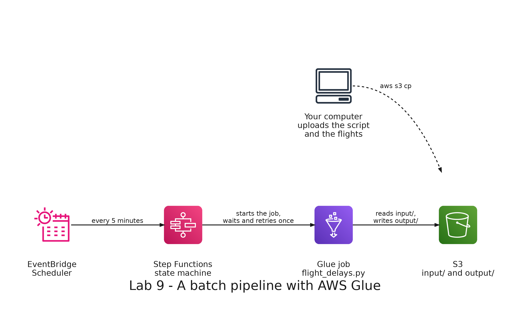

# README

- [README](#readme)
  - [Summary](#summary)
  - [Setup](#setup)
    - [Prerequisites](#prerequisites)
    - [Step 1: Generate the flights](#step-1-generate-the-flights)
    - [Step 2: Deploy the stack](#step-2-deploy-the-stack)
    - [Step 3: Upload the script and the flights](#step-3-upload-the-script-and-the-flights)
    - [Step 4: Run the Glue job](#step-4-run-the-glue-job)
    - [Step 5: Run the pipeline with Step Functions](#step-5-run-the-pipeline-with-step-functions)
    - [Step 6: Break the job and watch the retry](#step-6-break-the-job-and-watch-the-retry)
    - [Step 7: Run it on a schedule](#step-7-run-it-on-a-schedule)
  - [Remove](#remove)

---

## Summary

`Lab 9: a batch pipeline with AWS Glue` runs a Spark job in AWS Glue that computes the average departure delay of each airline by month from the flights, and coordinates it with AWS Step Functions and Amazon EventBridge Scheduler.

The Glue job reads the flights from S3 and writes the result to S3 as Parquet. A Step Functions state machine starts the job, waits until it finishes and retries it once if it fails. An EventBridge schedule starts the state machine every 5 minutes.

It has its own stack, with its own bucket, and does not need the stacks of the other labs.



---

## Setup

### Prerequisites

The development container must be running, with your credentials in `.envs/aws.env` and `.envs/sls.env`: see [Environment variables](../../README.md#environment-variables) in the root README. The stack deploys to the region `us-east-1`, so set `AWS_DEFAULT_REGION=us-east-1` in `.envs/aws.env`.

All the commands run in the terminal of the development container, in the repository folder. Set the names the commands use:

```bash
ACCOUNT=$(aws sts get-caller-identity --query Account --output text)
BUCKET=big-data-labs-pipeline-$ACCOUNT
JOB=big-data-labs-flight-delays
echo $BUCKET
```

### Step 1: Generate the flights

```bash
python3 labs/shared/generator/generate_flights.py --flights 1000000 --output labs/shared/output/lab09
```

It writes 1 million flights, one CSV file per month, in `labs/shared/output/lab09/flights`.

Expected: `Wrote 1000000 flights to labs/shared/output/lab09`, and 9 CSV files of about 88 MB in total.

### Step 2: Deploy the stack

```bash
(cd labs/09-glue-batch/serverless/pipeline && serverless deploy)
```

It creates the stack `big-data-labs-lab09-pipeline`: the S3 bucket, the Glue job `big-data-labs-flight-delays` with 2 workers of type G.1X, the state machine, the schedule (disabled) and the three IAM roles each of them uses.

### Step 3: Upload the script and the flights

CloudFormation does not upload the script of a Glue job, so you upload it yourself, together with the flights:

```bash
aws s3 cp labs/09-glue-batch/job/flight_delays.py s3://$BUCKET/scripts/flight_delays.py
aws s3 cp labs/shared/output/lab09/flights s3://$BUCKET/input/flights --recursive
```

### Step 4: Run the Glue job

```bash
RUN=$(aws glue start-job-run --job-name $JOB --query JobRunId --output text)
aws glue get-job-run --job-name $JOB --run-id $RUN --query 'JobRun.[JobRunState,ExecutionTime]'
```

Repeat the second command until the state is `SUCCEEDED`. Expected: an `ExecutionTime` of about a minute (69 seconds in the run of the maintainer). You can also follow the run in the Glue console, in the **Runs** tab of the job: <https://us-east-1.console.aws.amazon.com/gluestudio/home?region=us-east-1#/jobs>.

The job leaves one Parquet file in `output/delays/`. Download it and read it:

```bash
aws s3 cp s3://$BUCKET/output/delays/ labs/shared/output/lab09/delays --recursive
python3 -c "import pandas as pd, glob; print(pd.read_parquet(glob.glob('labs/shared/output/lab09/delays/*.parquet')[0]).head(12))"
```

Expected: 72 rows, one for each airline and month, with the columns `airline_code`, `month`, `flights` and `avg_delay_min`. The first one is `AND`, `2026-01`, 26172 flights and 9.9 minutes of average delay.

### Step 5: Run the pipeline with Step Functions

Get the ARN of the state machine and start an execution with the paths the job reads and writes:

```bash
MACHINE=$(aws stepfunctions list-state-machines --query "stateMachines[?name=='$JOB'].stateMachineArn" --output text)
aws stepfunctions start-execution --state-machine-arn $MACHINE --input "{\"input_path\": \"s3://$BUCKET/input/flights/\", \"output_path\": \"s3://$BUCKET/output/delays/\"}"
```

Open the state machine in the Step Functions console and choose the execution, to watch the state `RunGlueJob` go from running to succeeded: <https://console.aws.amazon.com/states/home?region=us-east-1#/statemachines>.

Expected: `RunGlueJob` turns green and the execution ends as `SUCCEEDED`. The state machine can take a little longer than the Glue run itself to notice that the job has finished.

### Step 6: Break the job and watch the retry

Start an execution with an input path that does not exist:

```bash
aws stepfunctions start-execution --state-machine-arn $MACHINE --input "{\"input_path\": \"s3://$BUCKET/input/missing/\", \"output_path\": \"s3://$BUCKET/output/delays/\"}"
```

The Glue job fails because it cannot read the path, the state machine waits 10 seconds and starts it once more, and when the second run also fails it moves to the state `JobFailed`. In the console, choose the state `RunGlueJob` in the execution and open its **Retry** tab to see the two attempts and why each one failed. Check the execution and the two failed runs of the job from the terminal:

```bash
aws stepfunctions list-executions --state-machine-arn $MACHINE --query 'executions[0].status' --output text
aws glue get-job-runs --job-name $JOB --max-items 3 --query 'JobRuns[].JobRunState'
```

Expected: `FAILED` for the execution, and two `FAILED` runs at the top of the list of runs.

### Step 7: Run it on a schedule

The schedule exists but is disabled. Deploy again, with a parameter that enables it:

```bash
(cd labs/09-glue-batch/serverless/pipeline && serverless deploy --param="scheduleState=ENABLED")
aws scheduler get-schedule --name $JOB --query State --output text
```

Expected: `ENABLED`.

The schedule has no start date, so it starts the first execution as soon as it is enabled and then one every 5 minutes. List the executions: new ones appear that you did not start:

```bash
aws stepfunctions list-executions --state-machine-arn $MACHINE --max-items 5 --query 'executions[].[name,status,startDate]'
```

Disable the schedule by deploying again without the parameter:

```bash
(cd labs/09-glue-batch/serverless/pipeline && serverless deploy)
aws scheduler get-schedule --name $JOB --query State --output text
```

Expected: `DISABLED`.

---

## Remove

Empty the bucket, remove the stack, delete its deployment bucket and the local files:

```bash
aws s3 rm s3://$BUCKET --recursive
(cd labs/09-glue-batch/serverless/pipeline && serverless remove)
aws s3 rb s3://us-east-1.cfn.lab09-pipeline.big-data-labs.$ACCOUNT.deploys --force
rm -r labs/shared/output/lab09
```
