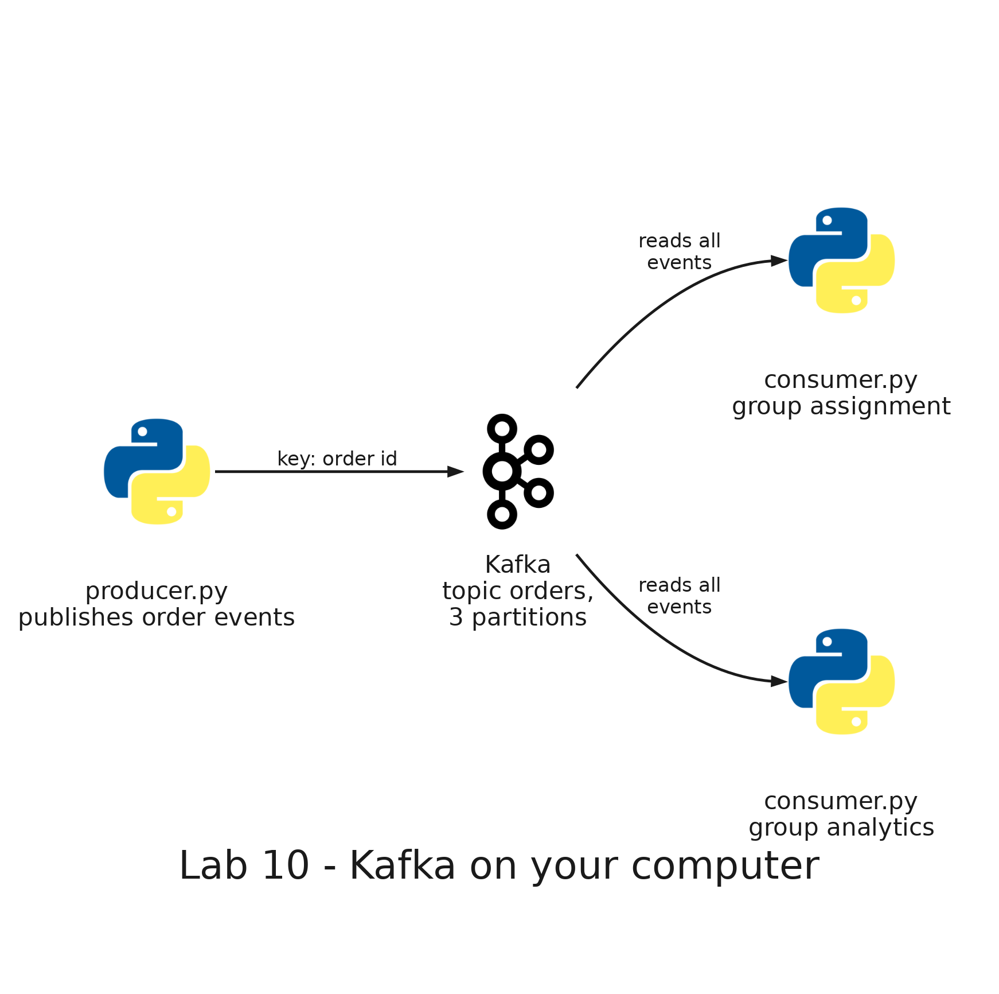

# README

- [README](#readme)
  - [Summary](#summary)
  - [Setup](#setup)
    - [Prerequisites](#prerequisites)
    - [Step 1: Create the topic](#step-1-create-the-topic)
    - [Step 2: Publish the events of six orders](#step-2-publish-the-events-of-six-orders)
    - [Step 3: Read the events with two groups](#step-3-read-the-events-with-two-groups)
    - [Step 4: Stop a consumer before it confirms its position](#step-4-stop-a-consumer-before-it-confirms-its-position)
    - [Step 5: Run two consumers in one group](#step-5-run-two-consumers-in-one-group)
    - [Step 6: Read what a group has not read](#step-6-read-what-a-group-has-not-read)
  - [Remove](#remove)

---

## Summary

`Lab 10: Kafka on your computer` runs a Kafka broker in a container and uses it with Python scripts. A producer publishes the events of the orders of a delivery app (`order_created`, `order_confirmed` and `order_delivered`) to the topic `orders`, which has three partitions, and the order id is the key of each event. Consumers read the topic in groups. You see which partition each event goes to and the offset it gets, how a group shares the partitions, what happens when a consumer stops before it confirms its position, and how a second group reads everything again.

It runs only on your computer: it needs no AWS account and deploys nothing.



The scripts are in this folder and run in the development container:

| Script        | What it does                                                                                             |
| ------------- | -------------------------------------------------------------------------------------------------------- |
| `topic.py`    | Creates or deletes the topic `orders`, with 3 partitions                                                 |
| `producer.py` | Publishes the three events of each order, with the order id as the key, and prints where each one landed |
| `consumer.py` | Reads the topic as a member of a group, confirms its position and prints the partitions it receives      |
| `describe.py` | Prints the first and next offset of each partition and, for a group, its members and its lag             |

---

## Setup

### Prerequisites

The development container needs the Kafka service, which starts with the container, and the `confluent-kafka` client, which the image of the repository installs. If you created the container before this lab, rebuild it: in Visual Studio Code, open the Command Palette and run `Dev Containers: Rebuild Container`.

Run every command of this lab from the root of the repository, inside the development container. Several steps use more than one terminal: in Visual Studio Code, open another one with **Terminal**, then **New Terminal**.

### Step 1: Create the topic

```bash
python3 labs/10-kafka/topic.py create
python3 labs/10-kafka/describe.py
```

Expected: `Topic orders: create done`, and a table with the three partitions, all with `first` and `next` at 0, because the topic is empty:

```text
partition  first   next
        0      0      0
        1      0      0
        2      0      0
```

`first` is the offset of the oldest event that the partition still holds, and `next` is the offset that the next event will get. While no event has been deleted, `first` is 0 and `next` is the number of events in the partition.

### Step 2: Publish the events of six orders

```bash
python3 labs/10-kafka/producer.py
python3 labs/10-kafka/describe.py
```

Expected: after about 9 seconds, 18 lines, one for each event, with the partition and the offset that Kafka assigned. The events are published by stage (all the `order_created`, then all the `order_confirmed`, then all the `order_delivered`), and the three events of one order always go to the same partition, because they have the same key:

```text
order 1201 order_created -> partition 0, offset 0
order 1202 order_created -> partition 2, offset 0
order 1203 order_created -> partition 0, offset 1
order 1204 order_created -> partition 1, offset 0
order 1205 order_created -> partition 0, offset 2
order 1206 order_created -> partition 1, offset 1
order 1201 order_confirmed -> partition 0, offset 3
...
order 1206 order_delivered -> partition 1, offset 5
```

Orders 1201, 1203 and 1205 are in partition 0, orders 1204 and 1206 in partition 1, and order 1202 in partition 2. Each partition has its own offsets, which start at 0. The second command shows how many events each one holds:

```text
partition  first   next
        0      0      9
        1      0      6
        2      0      3
```

### Step 3: Read the events with two groups

```bash
python3 labs/10-kafka/consumer.py --group analytics --name analytics
```

Expected: the line `[analytics] assigned partitions [0, 1, 2]`, because it is the only member of its group, and then 18 lines like `[analytics] partition 0, offset 0: order 1201 order_created`. The consumer reads one partition after another, and within each partition the events come in the order they were written. When it stops printing, press `Ctrl+C`: it prints `[analytics] stopped`.

Run another consumer in a different group:

```bash
python3 labs/10-kafka/consumer.py --group notifications --name notifications
```

Expected: the same 18 events. Reading does not delete them, and each group keeps its own position. Press `Ctrl+C` when it stops printing, and look at the group:

```bash
python3 labs/10-kafka/describe.py --group notifications
```

Expected: the group has no members, because the consumer stopped. The column `confirmed` is the offset that the group confirmed in each partition, and `lag` is `next` minus `confirmed`, the events the group has not read. Both groups have a lag of 0 in the three partitions:

```text
group notifications: EMPTY, 0 members

partition  first   next confirmed   lag
        0      0      9         9     0
        1      0      6         6     0
        2      0      3         3     0
```

### Step 4: Stop a consumer before it confirms its position

Publish the events of six more orders, without a delay between them:

```bash
python3 labs/10-kafka/producer.py --first-order-id 1301 --delay 0
python3 labs/10-kafka/describe.py --group notifications
```

Expected: the group `notifications` has 18 events to read, 6 in partition 0, 9 in partition 1 and 3 in partition 2:

```text
partition  first   next confirmed   lag
        0      0     15         9     6
        1      0     15         6     9
        2      0      6         3     3
```

Start the consumer slowly, so that it confirms its position only after every 10 events:

```bash
python3 labs/10-kafka/consumer.py --group notifications --name notifications --delay 1 --commit-every 10
```

Wait until it has printed at least 12 events and press `Ctrl+C`. Then look at the group:

```bash
python3 labs/10-kafka/describe.py --group notifications
```

Expected: the group confirmed its position after the first 10 events, so the events it read after that are not confirmed. For example, after 17 events:

```text
partition  first   next confirmed   lag
        0      0     15        15     0
        1      0     15        10     5
        2      0      6         3     3
```

In partition 2 the consumer read two events, but the confirmed offset is still 3. Start the consumer again, in the same group and confirming after every event:

```bash
python3 labs/10-kafka/consumer.py --group notifications --name notifications
```

Expected: it continues from the confirmed offset, not from the last event it read. The first lines are events it had already printed (for example `partition 1, offset 10` and `partition 2, offset 3`), and then the ones it had not read. A consumer that stops before confirming processes some events twice. Press `Ctrl+C` when it stops printing: `describe.py --group notifications` shows a lag of 0 in the three partitions.

### Step 5: Run two consumers in one group

Open three terminals. In the first one:

```bash
python3 labs/10-kafka/consumer.py --group assignment --name c1 --delay 0.5
```

In the second one:

```bash
python3 labs/10-kafka/consumer.py --group assignment --name c2 --delay 0.5
```

Expected: `assignment` is a new group, so its consumers start from the first event of the topic, and they share the events of the two batches published so far. At first, `c1` is assigned the three partitions. When `c2` joins, the group rebalances: `c1` prints `revoked partitions [0, 1, 2]` and then `assigned partitions [0, 1]`, and `c2` prints `assigned partitions [2]`.

In the third terminal, publish more orders while they read, and look at the group:

```bash
python3 labs/10-kafka/producer.py --first-order-id 1401 --delay 1
python3 labs/10-kafka/describe.py --group assignment
```

Expected: the group is `STABLE` with 2 members, each one reading different partitions, and each partition is read by one consumer only (the consumer that gets two partitions can be either one):

```text
group assignment: STABLE, 2 members
  c1: partitions [0, 1]
  c2: partitions [2]
```

Now press `Ctrl+C` in the second terminal, the one of `c2`.

Expected: `c2` prints `[c2] stopped`. The group rebalances and `c1` prints `revoked partitions [0, 1]` and `assigned partitions [0, 1, 2]`: the consumer that stays takes over the partitions of the one that left, and it continues from the confirmed offsets. Press `Ctrl+C` in the first terminal when `c1` stops printing.

### Step 6: Read what a group has not read

```bash
python3 labs/10-kafka/describe.py --group analytics
```

Expected: the group `analytics` only read the first batch of orders, and the groups `notifications` and `assignment` did not change that. Its lag is the 36 events published later:

```text
partition  first   next confirmed   lag
        0      0     18         9     9
        1      0     24         6    18
        2      0     12         3     9
```

Read them:

```bash
python3 labs/10-kafka/consumer.py --group analytics --name analytics
```

Expected: 36 events, and then `describe.py --group analytics` shows a lag of 0. Press `Ctrl+C` when it stops printing.

---

## Remove

```bash
python3 labs/10-kafka/topic.py delete
```

Expected: `Topic orders: delete done`. It deletes the events and the positions that the groups confirmed. The Kafka service keeps running while the development container is up, and nothing else was created.
