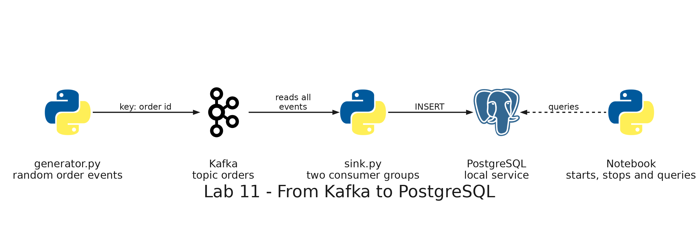

# README

- [README](#readme)
  - [Summary](#summary)
  - [Setup](#setup)
    - [Prerequisites](#prerequisites)
    - [Step 1: Open the notebook and connect to PostgreSQL](#step-1-open-the-notebook-and-connect-to-postgresql)
    - [Step 2: The helpers](#step-2-the-helpers)
    - [Step 3: Create the tables and the topic](#step-3-create-the-tables-and-the-topic)
    - [Step 4: Start the generator and two consumers](#step-4-start-the-generator-and-two-consumers)
    - [Step 5: Look at the rows](#step-5-look-at-the-rows)
    - [Step 6: Turn the events into the state of each order](#step-6-turn-the-events-into-the-state-of-each-order)
    - [Step 7: Stop the consumers](#step-7-stop-the-consumers)
    - [Step 8: Start the consumers again](#step-8-start-the-consumers-again)
    - [Step 9: The events that arrived twice](#step-9-the-events-that-arrived-twice)
    - [Step 10: Add a second consumer to a group](#step-10-add-a-second-consumer-to-a-group)
    - [Step 11: Reprocess every event](#step-11-reprocess-every-event)
  - [Remove](#remove)

---

## Summary

`Lab 11: From Kafka to PostgreSQL` connects Kafka to a database. A generator publishes random events of the orders of a delivery app to the topic `orders` without stopping, and two consumers insert them into two tables of the local PostgreSQL, so you can watch the tables grow with SQL. Then you stop the consumers as if they had failed, start them again, and see which events end up twice. One table accepts repeated events and the other one ignores them. Finally, a second consumer joins a group and the events are reprocessed from the beginning.

It runs only on your computer: it needs no AWS account and deploys nothing. It uses the Kafka service and the scripts `topic.py` and `describe.py` of lab 10.



The notebook starts each script as a process of its own, and killing a process works like a crash. The scripts are in this folder:

| Script             | What it does                                                                                                               |
| ------------------ | -------------------------------------------------------------------------------------------------------------------------- |
| `generator.py`     | Publishes random order events until it is stopped, with a unique `event_id` in each event and the order id as the key      |
| `sink.py`          | Reads the topic as a member of a group and inserts each event into a table, ignoring the repeated ones with `--idempotent` |
| `reset_offsets.py` | Moves the confirmed position of a group to the first event of each partition                                               |
| `common.py`        | The address of Kafka and the name of the topic                                                                             |

---

## Setup

### Prerequisites

The development container needs the Kafka and PostgreSQL services, which start with the container, and the notebook kernel, `psycopg` and `pandas`, which the image of the repository installs. If you created the container before lab 10, rebuild it: in Visual Studio Code, open the Command Palette and run `Dev Containers: Rebuild Container`.

The notebook creates the topic `orders` again, so it deletes the events that lab 10 left in it, if any.

### Step 1: Open the notebook and connect to PostgreSQL

In Visual Studio Code, open `labs/11-kafka-postgres/kafka_postgres.ipynb`. If it asks for a kernel, choose **Python Environments** and then `/usr/local/bin/python`. Run the cells one at a time, from the top.

Run the first code cell. It connects to PostgreSQL with the variables `PGHOST`, `PGUSER`, `PGPASSWORD` and `PGDATABASE` of the container and creates the folder for the logs.

Expected: the cell prints the version of PostgreSQL, for example `18.6 (Debian 18.6-1.pgdg13+2)`.

### Step 2: The helpers

Run the cell that defines the helpers.

Expected: no output. `query` returns the rows of a SQL statement as a table, `start` runs a script as a process with its output in a log, `stop` kills processes, `describe` prints the partitions and the position of a group, and `counts` and `watch` show how many rows each table has.

### Step 3: Create the tables and the topic

Run the next cell.

Expected: `Topic orders: create done`. The cell created the schema `lab_11` with two tables of the same columns. `order_events` has no key. In `order_events_unique`, `event_id` is the primary key, so its consumer can ignore an event that is already there. A consumer that gives the same result when it processes an event twice as when it processes it once is idempotent.

### Step 4: Start the generator and two consumers

Run the cell. The generator publishes about two new orders per second, and each one goes through `order_created`, `order_confirmed` and `order_delivered`, or `order_cancelled`. The consumer of the group `sink-plain` inserts the events into `order_events`. The consumer of the group `sink-unique` inserts them into `order_events_unique`, ignoring the ones already there. Each group reads all the events, and each consumer confirms its position in Kafka every 50 events.

Expected: every 3 seconds, a line with the rows of the two tables, which grow together:

```text
22:21:11  order_events: 4  order_events_unique: 4
22:21:14  order_events: 15  order_events_unique: 15
22:21:17  order_events: 29  order_events_unique: 29
22:21:20  order_events: 44  order_events_unique: 44
22:21:23  order_events: 61  order_events_unique: 61
```

### Step 5: Look at the rows

Run the cell.

Expected: the 8 newest events of `order_events`, each one with the partition and the offset where it was read. All the events of an order are in the same partition. For example:

```text
   order_id       event_type   restaurant  amount  kafka_partition  kafka_offset
0      5026    order_created  Sushi House   15.15                0            30
1      5025    order_created  Pizza Place   25.97                0            29
2      5017  order_delivered  Pizza Place   39.91                2            15
...
```

### Step 6: Turn the events into the state of each order

Run the cell. The last event of an order says where it is now, and the query keeps only that event for each order.

Expected: the 10 newest orders, each one with its status. The newest are `order_created`, and the older ones are further along:

```text
   order_id   restaurant  amount           status
0      5026  Sushi House   15.15    order_created
...
5      5021  Pizza Place   23.67  order_confirmed
...
9      5017  Pizza Place   39.91  order_delivered
```

### Step 7: Stop the consumers

Run the cell. It kills the two consumers, as if their computers had failed, while the generator keeps publishing.

Expected: for 15 seconds the number of rows does not change, and `describe` shows the group without members and with a lag in each partition: the events that Kafka holds and the group has not read. The column `confirmed` is the position that the group confirmed before the failure:

```text
group sink-unique: EMPTY, 0 members

partition  first   next confirmed   lag
        0      0     62        25    37
        1      0     36        12    24
        2      0     45        13    32
```

### Step 8: Start the consumers again

Run the cell. The consumers continue from the last position they confirmed, so the tables catch up with the events published while they were stopped. But they had inserted some events after their last confirmation, and they read them again.

Expected: the rows grow fast at first, and the table at the end shows that `order_events` has more rows than distinct events, because it inserted the repeated events again, and `order_events_unique` does not, because its consumer is idempotent and ignored them:

```text
            table_name  rows  distinct_events
0         order_events   278              267
1  order_events_unique   267              267
```

The number of repeated events depends on when you stopped the consumers: up to 49 per consumer.

### Step 9: The events that arrived twice

Run the cell. An event that was read twice has the same partition and the same offset in two rows.

Expected: a list of positions of Kafka that appear twice in `order_events`:

```text
   kafka_partition  kafka_offset  times
0                0            25      2
1                0            26      2
...
```

The offsets that appear twice start right after the confirmed offset of each partition in step 7 (25, 12 and 13).

### Step 10: Add a second consumer to a group

Run the cell. A second consumer joins the group `sink-unique`, and Kafka shares the 3 partitions between the two consumers. The cell waits 15 seconds for the group to rebalance.

Expected: `describe` shows the group with 2 members, one with two partitions and the other one with one (which one has two can change), and the tables keep growing with `distinct_events` equal to `rows` in `order_events_unique`:

```text
group sink-unique: STABLE, 2 members
  unique-1: partitions [0, 1]
  unique-2: partitions [2]
```

### Step 11: Reprocess every event

Run the cell. It stops the generator and the consumers, waits 12 seconds for Kafka to notice that the consumers are gone, and runs `reset_offsets.py` for each group, which moves its confirmed position to the first event of each partition. Then each consumer runs until it has no events left, and the cell prints the tables before and after.

Expected: `order_events` receives every event of the topic a second time, and `order_events_unique` does not change:

```text
                before                                     after
            table_name rows distinct_events           table_name rows distinct_events
0         order_events  421             410         order_events  831             410
1  order_events_unique  410             410  order_events_unique  410             410
```

Reading all the events again is how you recover from an error in the processing, and it is only safe when the consumer is idempotent.

---

## Remove

Run the last cell of the notebook. It drops the schema `lab_11`, closes the connection, deletes the topic `orders` and deletes the logs in `labs/shared/output/lab11`. The generator and the consumers were already stopped in step 11. If you stop before that, run `stop(generator, plain, unique, unique_2)` in a cell before the last one.
