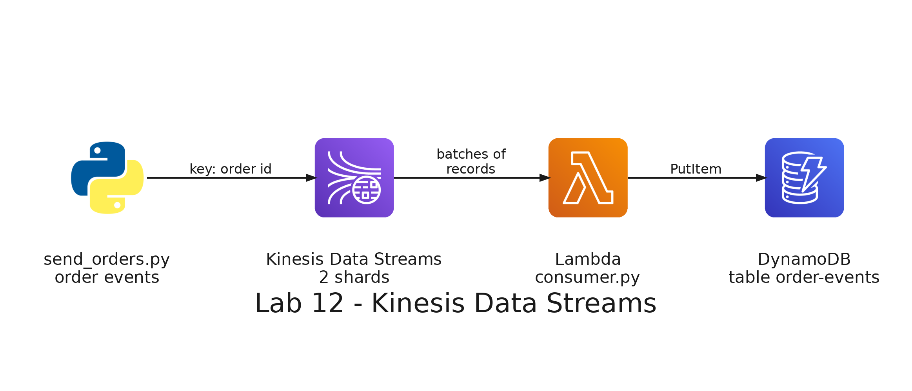

# README

- [README](#readme)
  - [Summary](#summary)
  - [Setup](#setup)
    - [Prerequisites](#prerequisites)
    - [Step 1: Deploy the stack](#step-1-deploy-the-stack)
    - [Step 2: Look at the shards](#step-2-look-at-the-shards)
    - [Step 3: Send the orders](#step-3-send-the-orders)
    - [Step 4: Read the records of a shard](#step-4-read-the-records-of-a-shard)
    - [Step 5: Look at the consumer](#step-5-look-at-the-consumer)
    - [Step 6: Query the orders in DynamoDB](#step-6-query-the-orders-in-dynamodb)
  - [Remove](#remove)

---

## Summary

`Lab 12: orders in real time with Kinesis Data Streams` sends the events of the orders of a delivery app to an Amazon Kinesis data stream. A Python program publishes the events with the order id as the partition key, an AWS Lambda function reads the stream and writes each event to an Amazon DynamoDB table, and you query the table. You also read the records of a shard directly, to see the partition key and the sequence number that Kinesis keeps for each record.

It has its own stack, with the stream, the table and the function, and does not need the stacks of the other labs. The stream stays after this lab so that the next labs read it.



The program that sends the events and the code of the function are in this folder:

| File                              | What it does                                                                                           |
| --------------------------------- | ------------------------------------------------------------------------------------------------------ |
| `producer/send_orders.py`         | Sends the events of the orders to the stream with `PutRecords`, with the order id as the partition key |
| `serverless/stream/consumer.py`   | The Lambda function: decodes each record of a batch and writes it to the table                         |
| `serverless/stream/functions.yml` | The definition of the function and of the mapping that makes it read the stream                        |
| `serverless/stream/iam.yml`       | The role of the function: it reads the stream and writes to the table, and nothing else                |
| `serverless/stream/kinesis.yml`   | The stream, with 2 shards, in provisioned mode, and a retention of 24 hours                            |
| `serverless/stream/dynamodb.yml`  | The table, with the order id as the partition key and the event type as the sort key                   |

---

## Setup

### Prerequisites

The development container must be running, with your credentials in `.envs/aws.env` and `.envs/sls.env`: see [Environment variables](../../README.md#environment-variables) in the root README. The stack deploys to the region `us-east-1`, so set `AWS_DEFAULT_REGION=us-east-1` in `.envs/aws.env`.

This lab needs the paid plan of your AWS account, as lab 5 does: see its prerequisites if your account is still on the free plan. Check that Kinesis is available:

```bash
aws kinesis list-streams
```

Expected: a list with no streams, `"StreamNames": []`, and not an error about a subscription for the service.

All the commands run in the terminal of the development container, in the repository folder.

### Step 1: Deploy the stack

```bash
(cd labs/12-kinesis/serverless/stream && serverless deploy)
```

It creates the stack `big-data-labs-lab12-kinesis`: a Kinesis stream called `big-data-labs-orders`, a DynamoDB table called `big-data-labs-order-events` and a Lambda function called `big-data-labs-orders-consumer`, with its permissions and the mapping that makes it read the stream. Check the stream:

```bash
aws kinesis describe-stream-summary --stream-name big-data-labs-orders --query 'StreamDescriptionSummary.[StreamStatus,OpenShardCount,RetentionPeriodHours]' --output text
```

Expected: `ACTIVE 2 24`: the stream is ready, has 2 shards and keeps its records for 24 hours.

### Step 2: Look at the shards

```bash
aws kinesis list-shards --stream-name big-data-labs-orders --query 'Shards[].[ShardId,HashKeyRange.StartingHashKey,HashKeyRange.EndingHashKey]' --output text
```

Expected: two lines, one for each shard. Each shard owns a range of hash key values. Kinesis calculates a hash of the partition key of each record, and the shard whose range contains that value receives the record.

### Step 3: Send the orders

```bash
python3 labs/12-kinesis/producer/send_orders.py --seconds 60
```

The program sends about 2 new orders per second for 60 seconds. Each order sends an `order_created` event, an `order_confirmed` event a few seconds later, and an `order_delivered` event, or an `order_cancelled` event in a few orders, a few seconds after that. Each event is a JSON record, and its partition key is the order id.

Expected: first, six lines with the shard and the sequence number that Kinesis gave to the first records, then a line every 10 seconds with the events sent and the failures, and at the end the number of events that each shard received.

To see how the events look without sending anything, run it with `--dry-run`.

### Step 4: Read the records of a shard

The program that reads the stream is the Lambda function, but you can also read a shard yourself. Ask for an iterator at the oldest record of the first shard and read three records:

```bash
SHARD=shardId-000000000000
ITERATOR=$(aws kinesis get-shard-iterator --stream-name big-data-labs-orders --shard-id $SHARD --shard-iterator-type TRIM_HORIZON --query ShardIterator --output text)
aws kinesis get-records --shard-iterator $ITERATOR --limit 3
```

Expected: three records, each one with its `SequenceNumber`, its `PartitionKey`, which is an order id, and its `Data`, which is the event encoded in base64. To read the first one:

```bash
aws kinesis get-records --shard-iterator $ITERATOR --limit 1 --query 'Records[0].Data' --output text | base64 --decode
```

Run the commands again with a new iterator: you get the same records. Reading a record does not remove it from the stream, and it stays until its retention period ends.

### Step 5: Look at the consumer

The function reads the batches of records of each shard and writes each event to the table. Look at its log:

```bash
aws logs tail /aws/lambda/big-data-labs-orders-consumer --since 15m
```

Expected: for each batch, the lines `START`, `END` and `REPORT` of Lambda, and a line `{"written": N}` with the number of records of the batch.

### Step 6: Query the orders in DynamoDB

The table has one item for each event, and its key is the order id and the event type. Query the events of the first order:

```bash
aws dynamodb query --table-name big-data-labs-order-events --key-condition-expression 'order_id = :id' --expression-attribute-values '{":id":{"N":"1001"}}' --query 'Items[].[event_type.S,occurred_at.S,shard_id.S]' --output text
```

Expected: the events of the order 1001, `order_created`, `order_confirmed` and `order_delivered` or `order_cancelled`, and the same shard in all of them, because they have the same partition key.

Count the items of the table, a minute after the program finishes:

```bash
aws dynamodb scan --table-name big-data-labs-order-events --select COUNT --query Count
```

Expected: the number of events that the program printed as sent.

---

## Remove

The stream stays in your account and keeps charging while it exists, so remove the stack when you finish the labs that use it. Remove the stack and delete its deployment bucket:

```bash
ACCOUNT=$(aws sts get-caller-identity --query Account --output text)
(cd labs/12-kinesis/serverless/stream && serverless remove)
aws s3 rb s3://us-east-1.cfn.lab12-kinesis.big-data-labs.$ACCOUNT.deploys
```
