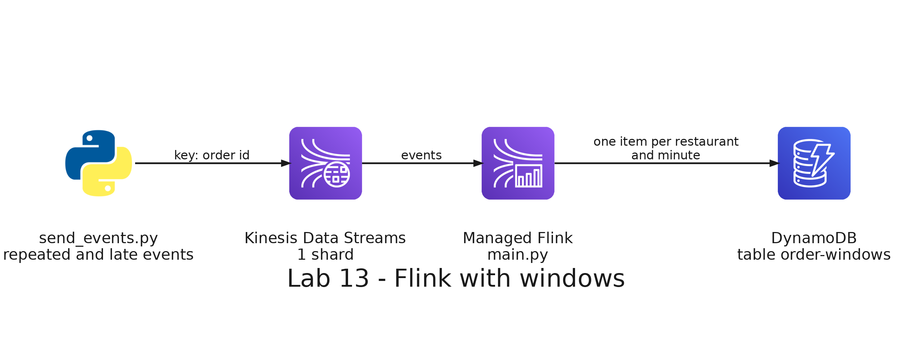

# README

- [README](#readme)
  - [Summary](#summary)
  - [Setup](#setup)
    - [Prerequisites](#prerequisites)
    - [Step 1: Deploy the stack without the application](#step-1-deploy-the-stack-without-the-application)
    - [Step 2: Build and upload the application](#step-2-build-and-upload-the-application)
    - [Step 3: Deploy the application](#step-3-deploy-the-application)
    - [Step 4: Start the application](#step-4-start-the-application)
    - [Step 5: Send the orders](#step-5-send-the-orders)
    - [Step 6: Read the windows](#step-6-read-the-windows)
  - [Remove](#remove)

---

## Summary

`Lab 13: Flink with windows` counts and averages the orders of a delivery app in windows of one minute. A program sends order events to a Kinesis stream, and some of them are repeated and some arrive 2 minutes late. An Apache Flink application, which runs in Amazon Managed Service for Apache Flink, reads the stream, counts each new order once, groups the orders by the time at which they happened in windows of one minute, and writes one item per restaurant and window to an Amazon DynamoDB table. You compare the windows with the orders that the program says it sent.

It has its own stack, with the stream, the application, its code bucket, its table and its role, and does not need the stacks of the other labs.



The files of the lab are in this folder:

| File                            | What it does                                                                                             |
| ------------------------------- | -------------------------------------------------------------------------------------------------------- |
| `producer/send_events.py`       | Sends order events, some of them repeated and some of them late, and prints the orders each minute needs |
| `app/main.py`                   | The Flink application: reads the stream, ignores repeated events and counts the orders in windows        |
| `app/pom.xml`                   | The connectors of Flink for Kinesis and DynamoDB, which Maven puts in one JAR                            |
| `app/build.py`                  | Builds the JAR and the zip that the service runs: `main.py` and the JAR                                  |
| `results.py`                    | Reads the DynamoDB table and prints the windows                                                          |
| `serverless/flink/kinesis.yml`  | The stream, with 1 shard, in provisioned mode, and a retention of 24 hours                               |
| `serverless/flink/flink.yml`    | The Managed Service for Apache Flink application and its log                                             |
| `serverless/flink/iam.yml`      | The role of the application: it reads the code, the stream and writes to the table, and nothing else     |
| `serverless/flink/s3.yml`       | The bucket that holds the zip of the application                                                         |
| `serverless/flink/dynamodb.yml` | The table, with the restaurant as the partition key and the start of the window as the sort key          |

---

## Setup

### Prerequisites

The development container must be running, with your credentials in `.envs/aws.env` and `.envs/sls.env`, and the paid plan of your AWS account, as in lab 12. If you created the container before this lab, rebuild it, because the image now includes Maven: in Visual Studio Code, open the Command Palette and run `Dev Containers: Rebuild Container`. Check Maven:

```bash
mvn -v
```

Expected: the version of Maven, `Apache Maven 3.8.7`, and a Java 17.

All the commands run in the terminal of the development container, in the repository folder.

### Step 1: Deploy the stack without the application

The application needs its code in S3 when it is created, so the stack is deployed in two steps. The first one creates everything but the application:

```bash
(cd labs/13-flink/serverless/flink && serverless deploy --param="application=skip")
```

It creates the stack `big-data-labs-lab13-flink`: the Kinesis stream `big-data-labs-flink-orders`, the bucket `big-data-labs-flink-<your account id>`, the table `big-data-labs-order-windows`, the role of the application and its log group. Check that there is no application yet:

```bash
aws kinesisanalyticsv2 list-applications --query 'ApplicationSummaries[].ApplicationName'
```

Expected: an empty list, `[]`.

### Step 2: Build and upload the application

```bash
python3 labs/13-flink/app/build.py
```

Maven downloads the connectors of Flink for Kinesis and DynamoDB, with their dependencies, and puts them in one JAR. The program puts the JAR and `main.py` in the zip `labs/13-flink/app/build/app.zip`.

Expected: a line with the zip and its size, about 39 MB. The first time it takes a few minutes, because of the download.

Upload the zip to the bucket:

```bash
BUCKET=big-data-labs-flink-$(aws sts get-caller-identity --query Account --output text)
aws s3 cp labs/13-flink/app/build/app.zip s3://$BUCKET/app/app.zip
```

Expected: the upload of a file of about 39 MB.

### Step 3: Deploy the application

```bash
(cd labs/13-flink/serverless/flink && serverless deploy)
```

It creates the application `big-data-labs-orders-flink`, with the runtime Flink 1.20, which reads the zip of the bucket and the stream. Check it:

```bash
aws kinesisanalyticsv2 describe-application --application-name big-data-labs-orders-flink --query 'ApplicationDetail.[ApplicationStatus,RuntimeEnvironment]' --output text
```

Expected: `READY FLINK-1_20`: the application exists but is not running.

### Step 4: Start the application

```bash
aws kinesisanalyticsv2 start-application --application-name big-data-labs-orders-flink
```

Run the check of the previous step every few seconds.

Expected: the status changes to `STARTING` and, after a few minutes, to `RUNNING`.

### Step 5: Send the orders

```bash
python3 labs/13-flink/producer/send_events.py
```

The program sends about 2 new orders per second for about 3 minutes, with the same events as lab 12: `order_created`, `order_confirmed` and then `order_delivered` or `order_cancelled`. Some events are sent twice, with the same `event_id`, and some new orders arrive with the time at which they happened 2 minutes before. To see the events without sending anything, run it with `--dry-run`.

Expected: a line every 10 seconds with the events sent and the failures, and at the end the number of events sent, how many of them were repeated or late, and the orders that each minute must have in the windows of Flink:

```text
189s: 1144 events sent, 0 failed
1144 events sent, 0 failed: 47 repeated and 17 late
Orders that each window of Flink must count (UTC):
  12:00  60
  12:01  120
  12:02  120
  12:03  60
```

The program sends the same events every time, and the minutes depend on when you start it, so your list has other times and other splits of the same orders. The orders of each minute are the ones that arrived on time, counted once: the repeated events and the late orders are not in the list.

### Step 6: Read the windows

```bash
python3 labs/13-flink/results.py
```

Expected: one line for each restaurant and each window that Flink has closed, with its number of orders and its average amount, and then the orders of each window. A window closes when the events show that its minute is over, and Flink cannot know it until an event of a later minute arrives, so the last minute is not in the table yet. The orders of the other windows are the ones the program printed for those minutes.

To close the last window, send a few more seconds of events, with order ids that you have not used, and read the windows again:

```bash
python3 labs/13-flink/producer/send_events.py --seconds 10 --first-order-id 3001
python3 labs/13-flink/results.py
```

Expected: the last minute of the first run is in the table, with the orders that the program printed for it.

Look at the log of the application:

```bash
aws logs tail /aws/kinesis-analytics/big-data-labs-orders-flink --since 15m
```

Expected: the log lines of the Flink job.

---

## Remove

Stop the application and wait until its status is `READY`:

```bash
aws kinesisanalyticsv2 stop-application --application-name big-data-labs-orders-flink --force
aws kinesisanalyticsv2 describe-application --application-name big-data-labs-orders-flink --query ApplicationDetail.ApplicationStatus --output text
```

Empty the bucket, remove the stack, which deletes the stream, the table and the application, and delete its deployment bucket:

```bash
ACCOUNT=$(aws sts get-caller-identity --query Account --output text)
aws s3 rm s3://big-data-labs-flink-$ACCOUNT --recursive
(cd labs/13-flink/serverless/flink && serverless remove)
aws s3 rb s3://us-east-1.cfn.lab13-flink.big-data-labs.$ACCOUNT.deploys
```
